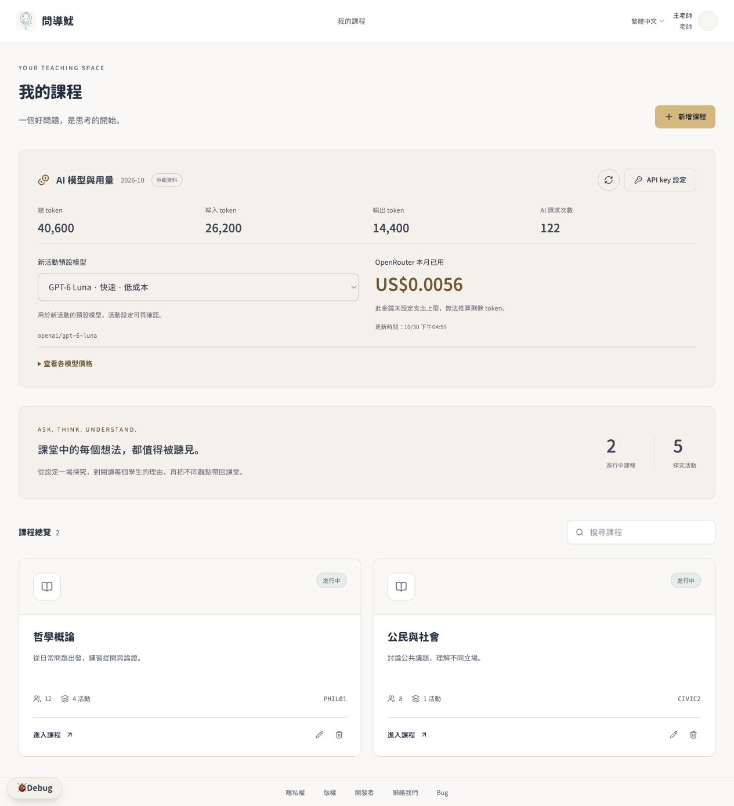

# 問導魷 SocratesBot

蘇格拉底式教學對話系統的 **v0.2 prototype**。這個分支與 PR 用於試用及確認設計，保持 **Draft／DO NOT MERGE**，請勿合併至 main 或作為正式服務部署。

前端可獨立執行：示範模式使用瀏覽器裡的 MSW 假後端，不需要啟動 Python、Docker、資料庫，也不需要真正的 AI API key。



## 下載與啟動原型

先安裝 Node.js 24.12 以上及 pnpm。本次驗證環境為 Node.js 26.12.1、pnpm 12.15.0。未安裝 pnpm 時可執行：

```sh
npm install --global pnpm@12.15.0
```

下載本次原型分支，而不是 main：

```sh
git clone --branch prototype/v0.2-do-not-merge --single-branch https://github.com/11501SoftwareEngineering/11501SoftwareEngineering-SocratesBot.git
cd 11501SoftwareEngineering-SocratesBot/frontend
pnpm install --frozen-lockfile
pnpm dev:mock --host 127.0.0.1 --port 5174
```

開啟 [本機原型頁面](http://127.0.0.1:5174/)。若 5174 已被使用，依終端機實際顯示的網址開啟，或改用其他 port。

也可在 GitHub 選擇 `prototype/v0.2-do-not-merge` 分支，使用 **Code → Download ZIP**，解壓後進入 `frontend`，從安裝步驟開始。取得儲存庫及 PR 需具備該儲存庫的讀取權限。

## 示範帳號

以下都是本機假資料帳號，密碼一律為 `password123`。首頁也提供教師、學生及助教的一鍵體驗。

| 身分 | 帳號 | 可試用內容 |
| --- | --- | --- |
| 老師 | `wang` | 課程、活動草稿、摘要審閱、助教權限、模型與用量。 |
| 助教 | `ta` | 已指派「哲學概論」；由老師逐項勾選權限。 |
| 學生 | `s001` 至 `s012` | 個人對話、報告及老師已發布的全班摘要。 |
| 管理員 | `admin` | 示範教師帳號管理。 |
| 初次登入示範 | `chen` | 登入後必須先修改初始密碼。 |

## 建議試用流程

1. 以 `wang` 登入，進入「哲學概論 → 善意的謊言是對的嗎？」查看完整示範。已有 12 份報告、3 組觀點及 2 位未定立場者。
2. 在「摘要審閱」查看分布與觀點總結；點擊任一 Perspective，自動切到學生報告並套用 tag。
3. 在課程新增探究，輸入描述或選擇研究主題，直接確認八欄；可給 AI 回饋、重新整理內容及單獨更新開場。
4. 草稿可修改；老師發布後八欄、內容語言及模型鎖定，舊編輯網址也只能檢視。
5. 在「助教與權限」勾選 `ta` 的操作範圍，再以助教體驗查看差異；發布與刪除仍由老師執行。
6. 回到老師首頁，查看合併的「AI 模型與用量」卡片；API key 設定請只填測試文字。
7. 以學生體驗進入尚未完成的活動，查看獨立對話、5／10／15 回合及完成報告流程。

介面採淺米色主題，保留繁體中文、英文及西班牙文切換。老師摘要頁只有「摘要審閱」「學生報告」兩個分頁，沒有學生版預覽、重複的摘要編輯區或全班時間軸；個人報告仍保留觀點變化時間軸。

## 假資料與已知限制

- AI 回覆、設定整理、分群、報告及金額為示範資料，不會向 OpenRouter 發出或計費請求。模型清單與單價不是正式供應商承諾。
- 請使用虛構內容及測試文字。示範版 key 只保存設定狀態與尾碼遮罩，不保存完整金鑰。
- 課程、對話、報告及假帳號等資料保存在目前網址的瀏覽器 localStorage；不同瀏覽器或不同 origin 各有一份。重新整理不會清除，切換帳號不會清除課程；Debug 臨時公告只在記憶體，重新整理後消失。
- 左下角 **Debug → 假資料 → 重置假資料** 可重建本機範例。這只影響目前瀏覽器的示範資料。
- 課程與活動採直接刪除，沒有封存。刪除本機範例後不會自動復原，需重置假資料。
- 模型與用量卡片可以操作及更新示範數值；正式驗證、AI、資料儲存、計費與安全控制仍需依 spec 串接後端。
- 若顯示無法連線，先確認使用 `pnpm dev:mock`，待頁面完成載入後重新整理；不要用一般 `pnpm dev` 來啟動無後端示範。

## 打包後提供他人預覽

在 `frontend` 執行：

```sh
pnpm build:demo
pnpm preview --host 127.0.0.1 --port 5174
```

輸出為 `frontend/dist`。靜態託管需支援 SPA 路由回退，並以 localhost 或 HTTPS 提供 Service Worker；不能直接雙擊 dist 裡的 HTML 執行。這份 mock 建置仍屬於原型展示。

## 檢查與測試

```sh
cd frontend
pnpm lint
pnpm exec vitest run
pnpm build
pnpm build:demo
```

Node 26 若遇原生 localStorage 與測試環境衝突，在 macOS／Linux 使用：

```sh
NODE_OPTIONS=--no-experimental-webstorage pnpm exec vitest run
```

PowerShell 可先設定 `$env:NODE_OPTIONS="--no-experimental-webstorage"`，再執行 `pnpm exec vitest run`。`pnpm build` 為正式模式，`pnpm build:demo` 才會啟用示範模式；要試用請使用後者。

## 前後端分工與相關文件

- [v0.2 前後端開發規格書](docs/SocratesBot_v0.2_前後端開發規格書.md)：最新產品決定、角色、流程、資料、API、前後端工作、驗收條件與待決事項；第 15 節逐項盤點全部功能及占位範圍。
- [Word 規格書](docs/SocratesBot_v0.2_前後端開發規格書.docx)：同版可下載文件；後續修訂以 Markdown 為基線。
- [前端三階段串接](docs/前端三階段串接.md)：原型 API 及正式串接差異。
- [前端開發說明](frontend/README.md)：目錄、開發流程及前端規範。
- [後端開發說明](backend/README.md)：正式後端環境、資料遷移及測試。
- [團隊開發須知](docs/開發須知.md)：既有協作規範。

舊 API 文件若與本次 v0.2 的年齡層、回合、預設結論類別或發布後編輯規則衝突，以 v0.2 spec 為開發基線；正式介接仍須共同確認 OpenAPI 與資料遷移。
