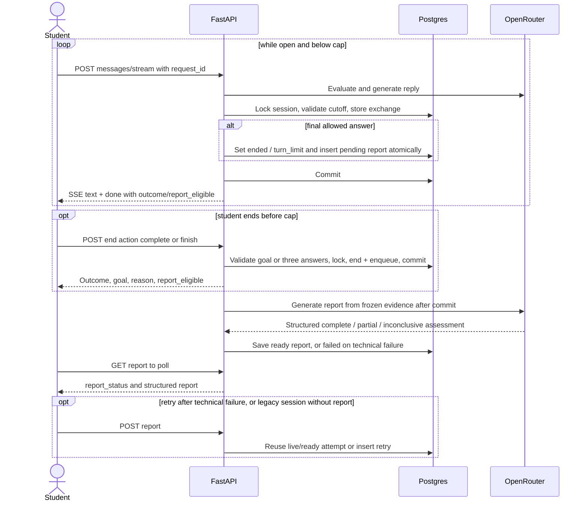

# AI backend API contract and sequences

Contract revision 8 (PR #272 teacher closure), 21 November 2026. Reconciled against PR #272 implementation `cf2c335` (including its dependency stack). Paths have the `/api/v1` prefix. This is a PR contract, not a statement that these changes are deployed.

- [PR #272 documentation preview](https://11501SoftwareEngineering.github.io/11501SoftwareEngineering-SocratesBot/pr-preview/pr-272/docs/) follows the published PR head after its docs workflow succeeds.
- [Main documentation](https://11501SoftwareEngineering.github.io/11501SoftwareEngineering-SocratesBot/docs/) follows the main deployment workflow; it does not include unmerged PR changes. Documentation deployment does not prove the backend service has been deployed.
- OpenAPI is generated from this checkout: run `python scripts/export_openapi.py -o ../docs/openapi/openapi.json` from `backend/`. The generated file is ignored by Git; CI builds it for the corresponding preview/main site. Local edits are not visible on either site until published and built.

## Authentication and error responses

Use the application's existing authentication/CSRF flow. These endpoints require an active authenticated account; 401 means authentication is required, and 403 can mean the password-change gate. Teacher-only routes additionally enforce their role/course checks. UUID/body validation returns 422 with a list under `detail`; application rejections commonly use a string under `detail`. Stage1 semantic rejection also uses 422 with a string. Do not assume every 422 has the same detail type.

Student history, reply, end and personal-report operations return **404**, not 403, for a missing or other-owner session. Session entry checks course membership separately and returns 403 for a nonmember. Setup read/save/generate/refine/opening allow the course teacher or a course TA with `edit_topics`. Publish remains restricted to the course teacher. Teaching report routes also still require the global teacher role.

## Teacher setup

| Operation | Input | Persistence and response |
| --- | --- | --- |
| POST `/courses/{courseId}/topics` | `age_band`, `max_turns`, `course_description`; optional `model_id`, `content_language` | Creates a setup topic after successful generation. Returns identifiers, setup and teacher feedback. |
| GET `/topics/{topicId}/setup` | None | Saved setup. Null-valued keys are omitted, including nested setup keys; tolerate missing optional fields. |
| POST `/topics/{topicId}/setup/generate` | `age_band`, `max_turns`, `content_language`, `course_description`, `model_id` | Returns a suggestion plus feedback. Does not save fields, language or model. The model must be in the catalog. |
| POST `/topics/{topicId}/setup/refine` | `setup`, `feedback` | Returns a suggestion plus feedback, without saving it. Uses the topic's effective model/language. |
| PUT `/topics/{topicId}/setup` | `setup`; optional `model_id`, `content_language` | Saves displayed fields and explicit selections. Omitted selections preserve stored values; null/blank selections are rejected. |
| POST `/topics/{topicId}/setup/opening-message` | `setup` | Returns **and saves** the new opening and records a revision. It does not save unrelated displayed fields. A concurrent write causes 409. |
| POST `/topics/{topicId}/publish` | `setup`; optional `model_id`, `content_language` | Saves fields/selections and publishes atomically. Invalid publication rolls back. Only age, cap, topic and core question are currently required by the publication gate; blank opening is permitted. |

Generation/refinement feedback: `assessments`, `clarification_questions`, `suggestions`, `warnings`. These are returned guidance, not separately persisted feedback. Treat missing optional response fields as unavailable. Preserve the teacher's draft on failure; the server does not durably save a rejected generation request.

Generation errors include 400 outside setup, 422 for request/semantic rejection, 502 for invalid provider output, 503 for unavailable service/incomplete substantive output, and 504 for the task timeout. See per-route OpenAPI for examples. Opening generation sends the effective content language and requests only `opening_message` using a dedicated schema (45-second timeout, at most500 output tokens). Missing/blank/malformed opening output returns502 without replacing the saved opening.

All course AI calls use the course owner's stored OpenRouter key when configured, including requests triggered by TAs/students and background report/synthesis jobs. Otherwise they use the single server OPENAI_API_KEY. Missing course/topic records or unreadable personal keys fail closed; teacher-key provider failures never switch to server billing. No rotating key pool is included. For teacher- and TA-created activities, model selection is explicit creation override → course owner (`Course.created_by`) saved default → server default. Explicit and saved selections must exist in the catalog; stale saved defaults return422. Language defaults to server configuration. These defaults affect only new topics. Generate/refine return the effective language/model; to adopt a generated selection, send it explicitly on Save/Publish. Model/language changes are recorded in inquiry revisions. No key belongs in a frontend payload, trace or example beyond the dedicated existing key-settings flow.

```mermaid
sequenceDiagram
    actor Teacher
    participant API as FastAPI
    participant Model as OpenRouter
    participant DB as Postgres
    Teacher->>API: POST /courses/{courseId}/topics
    API->>Model: Native Stage1 design request
    alt usable valid design
        API->>DB: Save setup topic and revision
        API-->>Teacher: setup and feedback
    else rejected or failed
        API-->>Teacher: 422 / 502 / 503 / 504, no new topic
    end
    Teacher->>API: POST /topics/{topicId}/setup/generate or refine
    API->>Model: Generate suggestion
    API-->>Teacher: setup and feedback, not saved
    opt opening regeneration
        Teacher->>API: POST /topics/{topicId}/setup/opening-message
        API->>Model: Generate opening
        API->>DB: Save opening and revision if not stale
        API-->>Teacher: opening_message
    end
    Teacher->>API: PUT setup or POST publish with setup and optional model/language
    API->>DB: Save; publish also enters conversation
    API-->>Teacher: Stored setup and status
```

## Session state and dialogue transport

POST `/topics/{topicId}/sessions` creates or returns the same session. Setup topics return 404; summary topics return an existing session but reject creation of a missing one with 400. Existing ended sessions are returned as ended, not reopened. The endpoint currently checks course membership, not an exclusive student course role.

The name `session_status` has two endpoint-specific meanings:

| Endpoint family | Values |
| --- | --- |
| Session entry, history, end | `open`, `completed`, `ended`, `abandoned`, `closed_by_summary` (dialogue outcome) |
| Student rows in course-topic list | `IN_PROGRESS`, `COMPLETED`, or null before entry (legacy status) |

Do not decide reply eligibility from the course-list enum. Use session history and topic stage. `open` alone does not guarantee another turn: the cap may already be spent. The opening shown in history is not a counted student turn.

POST `/sessions/{sessionId}/messages/stream` takes:

```json
{"content":"I think access matters because people need to get to work.","request_id":"11111111-1111-4111-8111-111111111111"}
```

Use authenticated POST streaming (for example, `fetch` with a stream reader); native `EventSource` does not send this POST body. Inference and persistence finish **before** the SSE response begins. Successful content type is `text/event-stream`; this is not progressive provider token streaming. Parse SSE event boundaries, not individual network chunks.

```text
data: What would change your view?
data: Consider who pays for the service.

event: done
data: {"message_id":"44444444-4444-4444-4444-444444444444","completed_turns":3,"is_completed":false,"awaiting_end_consent":true,"session_status":"open","goal_reached":true,"report_eligible":false,"ending_reason":null,"can_finish_early":true}

```

The first event is unnamed (standard event type `message`), containing the whole visible reply. Join its data lines with LF; CR/CRLF input normalizes to LF. The final named `done` event contains JSON with four required fields. OpenAPI documents the stream as a string and exposes each event schema in the `x-sse-events` response extension; it is not a JSON HTTP response. No SSE `id:` or Last-Event-ID resumption is provided.

`awaiting_end_consent=true` asks the client to offer an ending choice. It does not make the session completed or report-eligible. A new reply currently has `is_completed=false`; replay of an older committed reply can reflect a now-completed session. Replayed count/flags reflect current session state, while text/message ID identify the stored reply.

Errors before SSE starts are ordinary JSON responses: 400 closed/capped, 404 missing/other owner, 409 busy/stale/ended during generation, 413 context-budget rejection, 422 request validation, 502 model/output failure, or 503 availability/tokenizer configuration failure, plus authentication errors. Check HTTP status/content type before parsing events.

Retry the same logical submission with the same `request_id` **and content**. Once committed, its reply is replayed without another inference or stored turn. A new submission needs a new ID. A failed model turn has no durable pending student receipt; retain the draft until success and reload history after an ambiguous disconnect. The busy guard is process-local: neither cross-worker exactly-once inference nor exactly-once provider billing is guaranteed. Do not automatically retry model failures indefinitely.

## Ending and starting reports

| End action | Result |
| --- | --- |
| `complete` | Requires historical goal achievement, otherwise409. Outcome `completed`, reason `goal_reached`; enqueue report. |
| `finish` | Requires at least three stored student answers, otherwise409. Outcome `ended`, reason `student_requested_stop`; preserve goal and enqueue report. |
| `continue` | Keep `open`, clear consent, preserve achieved goal; never extend cap. |
| `abandon` | Existing behavior: outcome `abandoned`, clear goal/consent, no report. Do not use this for Finish early. |

At the final allowed student answer, the backend commits the reply, progress, outcome `ended`, reason `turn_limit`, and pending report in one transaction. It requires no subsequent end request. Report model work starts after commit. A provider failure before reply persistence leaves the answer uncommitted; retry the same request ID. Browser closure is not an ending action.

History, end and SSE done expose `report_eligible`, `ending_reason`, `can_finish_early`. SSE also exposes `session_status` and `goal_reached`. Use outcome/report_eligible to navigate, NOT is_completed alone: is_completed retains its completed-outcome meaning, and is false for ended sessions. At the cap consent is false even when the goal was achieved. End/history/SSE all preserve historical goal achievement. `ended_at` records any report-producing end; `completed_at` retains successful completion semantics. Report completion_reason is goal_reached/student_requested_stop/turn_limit/teacher_ended_stage2 (legacy completed remains readable).

Repeated same terminal action returns200 without enqueuing another attempt. Finish after cap returns the existing ended result. Conflicting terminal actions return409. The session row lock serializes end and reply persistence across workers; if end wins, an in-flight model result cannot append to the closed transcript. Same-process busy replies return409. This does not guarantee exactly-once model billing.



GET report never starts generation. It returns409 for ineligible outcomes,404 for no attempt (possible for legacy sessions), and200 with pending/processing/ready/failed otherwise. New report-producing endings enqueue automatically. POST remains the recovery/reuse endpoint. Inconclusive is a valid ready report, not a technical failure: evidence_status=insufficient, with observed evidence and limitations. Prefer useful partial summaries whenever possible; no goal achievement or milestone requirement gates report generation.

| Newest attempt at POST | Behavior |
| --- | --- |
| None | Insert pending attempt, snapshot progress and schedule |
| Pending/processing with unexpired lease | Reuse |
| Ready | Reuse; not forced regeneration |
| Failed or expired pending/processing | Insert and schedule a new attempt |

Teacher POST `/topics/{topicId}/reports/{sessionId}` uses the same retry/reuse rules, except that a ready report with missing/invalid native evidence or a mismatched inquiry can be regenerated for Stage3 compatibility. A valid native ready report is reused. It is not “always generate another report.” Snapshot refresh occurs only on insertion. A latest failed/running attempt may coexist with an older ready body: `report_status` describes the newest attempt, while `report` is the latest available ready body or null. Stop normal polling on ready/failed and present appropriate recovery; no fixed server polling interval is promised.

```json
{"report_status":"pending","report":null}
```

Reports retain validated timeline citations and private native summaries from Chunk05. Reports expose server ending metadata and goal_reached separately; anonymous_id remains undefined. Teaching counts retain completed_count for successful completion and add ended_count for early/cap endings. Ready/failed counts include both. Native Stage3 is included below. Per-student group tags are not returned by the teaching report list.

## Scope and verification

Chunk06 adds lifecycle, migration, automatic enqueue, evidence policy and API documentation. Local mock tests do not establish real-Postgres concurrency or live-model summary quality. See the chunk handoff for validation and deployment prerequisites.

## Dialogue contract repairs (Chunk04)

`goal_reached` is historical eligibility to complete, not the latest model's milestone state. Continue preserves it. After another saved reply, including an off-topic reply, the stored ending-choice flag and SSE done flag agree and offer completion again when eligibility was already achieved. History returns `current_progress` separately; its milestones may regress without erasing achievement. Chunk06 adds the ending behavior above.

The planner receives `approvedInquiryBrief`, `interfaceLanguage`, and `dialogueRecord`; the brief includes the turn cap. Context compaction budgets this actual envelope and planner schema. Validity, status, planning and legacy catch-up each check their request schema/material/output reserve before their provider call. Oversized requests return413; missing tokenizer support returns503. Legacy catch-up fails explicitly on oversized history rather than silently truncating evidence.

Progress references must identify an existing positive student exchange. Invalid or future references are rejected as model output errors before persistence; structural references alone do not prove that the cited text supports the claim.


## Default model selection

The configured defaults for `OPENAI_MODEL` and `OPENAI_VALIDITY_MODEL` are `openai/gpt-6.1-sol`, as selected by the project owner. Existing environment overrides still win. Saved teacher/topic selections also remain unchanged. Validity, status, planning, context compression, progress catch-up, personal reports and class synthesis use the saved activity model, falling back to OPENAI_MODEL only when absent. OPENAI_VALIDITY_MODEL remains accepted for configuration compatibility but no longer controls course dialogue. New report source snapshots and summary requests retain the resolved model; legacy pending snapshots acquire it once from their topic. Credentials are looked up at execution and never frozen in evidence/attempt JSON. This is configuration compatibility with the existing catalog/tokenizer mapping, not a live OpenRouter availability or output-quality certification.


## Native individual reports (Chunk05)

Personal report generation now sends `interfaceLanguage`, the approved inquiry brief, a numbered `transcript`, the attempt's `finalProgress`, and truthful `endingReason`. The owned report-eligible dialogue is snapshotted and committed before the model call. A fingerprint binds the saved input to the stored native summary; model/prompt versions are recorded. The native summary and source stay in private attempt metadata, outside student/teaching report bodies. Class synthesis privately consumes the validated native evidence.

The provider schema matches the native lab's outcome/workingPosition/strongestReason/challengeExamined/revisionOrDefence/focalTensionConnection/remainingQuestion/reflection/unmetElements fields. Native `outcome` describes the evidence result, not backend dialogue termination or job status. A partial/insufficient-evidence result can be a successfully generated ready report. Both `completed` and `ended` dialogues are report-eligible; `abandoned` is not.

Public report keys remain compatible. Reflection/working position, strongest reason, revision, focus connection, remaining question and limitations map to their existing fields. `viewpoint_status`, `other_perspectives`, and timeline viewpoint/change fields stay empty when the native contract cannot establish them. `challenges.responded` uses validated examination/response progress rather than an invented boolean. Timeline is a chronological student-evidence index, not a claim about causal changes in belief. `attribution=none` means no change attribution is made.

New timeline items retain string `evidence` and add `evidence_reference: {message_id, turn, quote}`. Quotes are copied from stored student messages; the validator checks ownership-derived source, turn, ID, question and exact quote, and rejects duplicates/malformed entries. This checks source integrity, not whether every model interpretation is philosophically or semantically justified. Legacy stored reports remain readable but are not retroactively certified.

`completed_at`, when available, comes from the session's server timestamp. `anonymous_id` remains unimplemented pending an agreed alias scope; clients must not assume it exists. Reports larger than `REPORT_CONTEXT_TOKEN_BUDGET` (default32000 estimated request tokens including output reserve) fail before provider invocation rather than silently dropping evidence. This is a configurable local guard, not a guarantee of provider context capacity. Existing retry/poll behavior remains. Native Stage3 consumes these saved sources as described below.


### Model and credential routing (combined Chunk07/08)

```mermaid
sequenceDiagram
    participant Caller as Teacher / TA / Student / Job
    participant API as Backend
    participant DB as Postgres
    participant Model as OpenRouter
    Caller->>API: Existing course operation
    API->>DB: Authorize operation; load course owner and activity
    API->>API: Resolve saved model (or explicit Stage1 generation override)
    API->>DB: Load course owner's encrypted credential
    alt Personal credential exists and can be decrypted
        API->>Model: Selected model + personal credential
    else No personal credential configured
        API->>Model: Selected model + single server credential
    end
    Model-->>API: Result or failure (no billing-account failover)
    API->>DB: Validated result and nonsecret provenance
    API-->>Caller: Existing response / job status
```

An unreadable credential or missing ownership record stops before a provider request. Model failures preserve existing API error/job-failure contracts. There are no new request fields or frontend changes. Summary model/language are captured when enqueued; report model is captured with its source before inference. Retrying an existing captured request retains its model; a new attempt may resolve current configuration. Native Stage3 uses the same model and credential routing.


## Native Stage3 class synthesis

Individual reports are queued at each qualifying dialogue ending and are immediately readable by their owner when ready. They do not wait for class synthesis or teacher publication.

POST `/topics/{topicId}/summary` requires **all existing dialogues for that topic to be non-open**, and the **latest attempt for every report-eligible dialogue (`completed` or `ended`) to be ready**. Pending, processing, failed or missing personal reports block with409; an older ready result does not bypass a newer failed/pending attempt. Abandoned and historical closed_by_summary sessions are not report-eligible and are not in the denominator. Students who never entered a session are not counted as open dialogues.

Ready reports without matching native summary/source evidence must be regenerated using the existing teacher report retry endpoint. Source-digest or inquiry-setting mismatches return409 rather than silently omitting records or fabricating evidence. No ready cohort returns400. More than50 reports or an oversized payload/model request returns413. Unsupported model tokenization returns503. There is no automatic batching or truncation.

A summary attempt freezes the selected report IDs, session IDs, source digests, converted native arguments, language and activity model. Model material contains temporary labels and evidence-grounded argument summaries, not raw transcripts or database IDs. The model proposes groups based on positions and reasons, with shared values, assumptions, internal differences and discussion questions. Backend validation rejects duplicate, unknown or ineligible membership and computes all counts/percentages. Participating inconclusive and unassigned reports remain in the denominator and appear as ungrouped in the existing public DTO; privately they form Still exploring. If all reports are unclassifiable, the backend creates an honest deterministic summary without calling the provider.

During a live pending/processing summary lease, new session creation returns409; existing sessions remain readable. Topic locking serializes entry and synthesis. At ready commit, the backend rechecks open sessions and selected report IDs; a changed cohort fails the attempt instead of closing new dialogues or publishing a stale cohort. Failed/expired jobs do not permanently block session entry. For direct synthesis, topic stage changes to summary on successful ready commit. The explicit teacher closure operation below enters summary immediately, with preparation status indicating that reports/synthesis are still pending. **Synthesis no longer changes open sessions to closed_by_summary.**

Native results and source mappings remain private in attempt/version JSON. Existing teacher `overview`/`viewpoint_summary` fields contain the projected native content; existing groups/count fields remain unchanged. Text edits retain private provenance and invalidate review. Publish uses the latest reviewed version and excludes private fields; regeneration preserves an existing published version until explicit replacement. Known names/identifiers and generated temporary-label leakage are checked, but this is not a guarantee of perfect anonymity or correct philosophical interpretation. Teacher review remains necessary.

Legacy pending summary requests from the old schema fail safely and must be restarted through POST summary. Existing published summaries remain readable. No database migration or frontend changes are required.

```mermaid
sequenceDiagram
    participant Student
    participant API as Backend
    participant DB as Postgres
    participant Model as OpenRouter
    participant Teacher
    Student->>API: Complete / finish early / final allowed answer
    API->>DB: End this dialogue and queue personal report
    API-->>Student: Ending response (report queued)
    Note over API,Model: Background personal-report job
    API->>Model: Generate personal report
    API->>DB: Store ready report
    Student->>API: GET own report (no class wait)
    Teacher->>API: POST topic summary
    API->>DB: Lock topic; check no open dialogues and every eligible report ready
    alt Open dialogue or missing/failed/incompatible report
        API-->>Teacher: 409 with recovery instruction
    else Cohort ready and within limits
        API->>DB: Freeze native cohort; queue synthesis
        API-->>Teacher: 200 preparation_status=pending, summary=null
        Note over API,DB: Background job; new session entry blocked during active lease
        alt At least one classifiable report
            API->>Model: Inquiry, language, temporary report labels and arguments
            Model-->>API: Qualitative groups and discussion material
        else All reports unclassifiable
            API->>API: Deterministic insufficient-evidence result
        end
        API->>API: Validate membership and compute counts
        API->>DB: Recheck cohort; save private native draft; topic becomes summary
        Teacher->>API: GET summary (poll preparation_status)
        API-->>Teacher: ready + draft, or failed (previous publication preserved)
        Teacher->>API: Edit / review / publish exact version
        Student->>API: GET published class summary
        API-->>Student: Anonymous aggregate projection
    end
```


## API change log and caller migration guide

This guide describes the accumulated AI/backend stack (PRs260–264,267,268,272), with implementation verified at `cf2c335` and published documentation corrections at `459b816`. It is a change/adoption guide, not a claim that every listed endpoint is newly introduced: many existing paths retain their public shape while their behavior is repaired. This expanded guide is a documentation follow-up on the same PR branch; publication does not imply backend deployment. All paths below are relative to `/api/v1`.

### 1. Stage1: setup generation and persistence

| Endpoint | Changed or clarified contract | Caller action |
|---|---|---|
| POST `/courses/{courseId}/topics` | Optional `model_id` and `content_language`. Model fallback uses the course owner's saved default, including when a TA creates the topic, then server default. Invalid catalog selections/defaults return422. Creation waits for valid generation before persisting the topic. | Send explicit selections when overriding defaults. Preserve the entered draft after an error. |
| GET `/topics/{topicId}/setup` | Optional null-valued fields can be omitted, including nested setup fields. | Do not require every optional key to exist. |
| POST `/topics/{topicId}/setup/generate` | Returns generated setup and feedback plus effective model/language. Generation does not save the proposed setup or model/language. | Present the suggestion for adoption; send its selections on Save/Publish. |
| POST `/topics/{topicId}/setup/refine` | Returns an unsaved suggestion from `setup` and `feedback`, using the topic's effective model/language. | Do not treat refinement success as a durable save. |
| PUT `/topics/{topicId}/setup` | Accepts `setup` and optional `model_id`, `content_language`. Omission preserves stored selections; explicit null/blank is rejected. | Include changed selections explicitly, alongside the displayed setup. |
| POST `/topics/{topicId}/publish` | Same explicit selection persistence, with save and publication in one transaction. Publication remains teacher-only. | Handle validation failure without assuming any partial save. |
| POST `/topics/{topicId}/setup/opening-message` | Dedicated opening-only model output; effective language supplied. Saves only the generated opening and its revision. Concurrent edits return409; invalid opening returns502 without overwriting the prior one. | Replace the opening only after success. Do not assume other displayed setup edits were saved. |

Setup read/save/generation/refinement/opening support the course teacher and authorized TA (`edit_topics`). This permission change does not grant TAs the teacher-only report/summary APIs. Feedback fields are `assessments`, `clarification_questions`, `suggestions`, `warnings`; feedback is guidance, not separately saved content. Stage1 request/semantic validation can return422, provider output502, service/substantive availability503, timeout504, and non-setup operations400. Authentication and ownership checks still apply.

### 2. Stage2: session entry, history and SSE

No direct frontend-to-model integration is needed. Frontend submits answers to the backend; backend owns inference, evidence validation and persistence.

| Endpoint | Change / actual behavior |
|---|---|
| POST `/topics/{topicId}/sessions` | Reuses this student's existing session without reopening it. A new session is refused with409 while a summary attempt has an active lease. Existing sessions remain retrievable. New entry after topic stage `summary` returns400; setup is hidden with404. |
| GET `/sessions/{sessionId}/messages` | Includes historical `goal_reached` and separate `current_progress`. Also exposes `report_eligible`, `ending_reason`, `can_finish_early`. Current milestones may regress without erasing previously earned completion eligibility. |
| POST `/sessions/{sessionId}/messages/stream` | Request remains `content` (nonblank, at most6000 characters) and `request_id`. One unnamed SSE text event precedes named `done`; inference finishes before SSE begins. `done` includes lifecycle fields below. |

The complete `done` payload has `message_id`, `completed_turns`, `is_completed`, `awaiting_end_consent`, `session_status`, `goal_reached`, `report_eligible`, `ending_reason`, `can_finish_early`. `current_progress` is available from history, not part of the SSE done schema. Reply text is in the unnamed event, not a JSON `text` field in done.

| Field | Meaning / integration consequence |
|---|---|
| `session_status` | Actual dialogue outcome: `open`, `completed`, `ended`, `abandoned`, legacy `closed_by_summary`. Do not confuse it with course-list legacy status labels. |
| `goal_reached` | Historical achievement, preserved through Continue and report-producing endings. It is not equivalent to the newest progress snapshot. |
| `awaiting_end_consent` | Offer the end/continue decision. It is not a server-enforced requirement to submit that decision before another reply. |
| `is_completed` | True only for outcome `completed`; an `ended` session can have a report while this remains false. |
| `report_eligible` | Whether this ending permits a report. It is not report readiness. Poll the report endpoint separately. |
| `can_finish_early` | Server-computed eligibility for explicit early finish; do not count the opening as a student answer. |
| `ending_reason` | `goal_reached`, `student_requested_stop`, `turn_limit`, or null when no such ending applies. |

Pre-stream errors are ordinary JSON, not SSE:400 closed/capped or invalid topic phase;404 missing/non-owned session;409 busy/stale state;413 context budget;422 bad request;502 model/output failure;503 unavailable service/tokenizer. For ambiguous network failures, reload history and retry the same logical answer using the same request ID and content. Committed answers replay; a new answer needs a new ID. This does not promise exactly-once provider billing across workers or failures.

### 3. Ending: actions, outcomes and automatic reporting

POST `/sessions/{sessionId}/end` accepts `{"action":"complete"}`, `continue`, `finish`, or `abandon`.

| Action/event | Preconditions | Stored outcome | Report behavior |
|---|---|---|---|
| `complete` | Goal eligibility achieved | `completed`; reason `goal_reached` | Pending report queued atomically with ending |
| `continue` | Dialogue still accepts this action | Remains `open`; consent cleared, achievement retained | No ending/report yet; cap unchanged |
| `finish` | At least three stored student answers | `ended`; reason `student_requested_stop` | Pending report queued, regardless of goal achievement |
| Final allowed answer | Reply successfully persisted at cap | `ended`; reason `turn_limit` | Automatic backend ending and report enqueue; no extra end POST required |
| `abandon` | Existing abandon action | `abandoned` | No report; do not use for the report-producing Finish early flow |
| Browser closure | No API ending | Unchanged | Does not automatically end or queue a report |

End responses contain `session_id`, `session_status`, `message`, `goal_reached`, `report_eligible`, `ending_reason`, `can_finish_early`. Insufficient turns for finish or missing goal for complete returns409. Same terminal action is idempotent; incompatible terminal action returns409. Finish after automatic cap ending returns the existing ended result. Malformed action returns422; missing/non-owned session404.

Caller flow: show end/continue on consent; offer early finish when eligible; after done/end reports an eligible ending, navigate to personal-report polling even if `goal_reached=false` or `is_completed=false`.

### 4. Personal reports: eligibility, content and recovery

| Endpoint | Contract |
|---|---|
| GET `/sessions/{sessionId}/report` | Owner-only read. Does not start generation. 200 contains `report_status` and `report`;409 ineligible outcome;404 missing/non-owned session or no attempt yet. |
| POST `/sessions/{sessionId}/report` | Owner-only recovery/start. Reuses a ready attempt or a live pending/processing attempt. Missing, failed or expired attempt starts a new one. It is not an unconditional regenerate operation. |
| POST `/topics/{topicId}/reports/{sessionId}` | Teacher/instructor recovery, with the additional ability to regenerate ready reports that lack valid native evidence or no longer match the inquiry. Compatible ready reports are reused. |
| GET `/topics/{topicId}/reports` | Teacher/instructor list. Includes `class_size`, `completed_count`, new `ended_count`, `ready_count`, `processing_count`, `failed_count`, and `reports` items containing `report_status`, `report`, `student_display_name`. |

Both `completed` and `ended` are eligible; abandoned/historical closed-by-summary sessions are not. `report_status` is `pending`, `processing`, `ready` or `failed`. Latest status and latest available ready body are separate: a failed/rebuilding attempt may accompany an older readable report. Stop routine polling at ready/failed; use POST for appropriate recovery.

Report content preserves the existing projection: `viewpoint_summary`, `final_viewpoint`, `viewpoint_status`, `reasons`, `strongest_reason`, `challenges`, `revision_or_defense`, `focus_connection`, `other_perspectives`, `open_questions`, `evidence_status`, `limitations`, `timeline`, plus report/session/topic identifiers and version/turn metadata. Optional or unsupported fields may be absent or empty; do not invent defaults that imply evidence.

Additions/clarifications:

- `ended_at` records a report-producing end; `completed_at` retains successful-completion meaning. `goal_reached` is independent of report readiness.
- `completion_reason` reflects goal achievement, explicit early stop or turn limit. Legacy `completed` values remain readable.
- `evidence_status`: `sufficient`, `partial`, `insufficient`. Insufficient evidence is a valid **ready structured report**, with useful supported observations and limitations; it is not automatically a failed job or a one-line replacement for the report.
- New timeline items preserve `evidence` and add `evidence_reference` with `message_id`, `turn`, `quote`, checked against stored student messages. Legacy items remain readable without retroactive validation.
- Native summary/source/provenance stay private. `anonymous_id` is not guaranteed. The teaching report list does not supply per-student `group_ids`, a group catalog or `summary_version`.
- Students may read their ready personal report immediately; teacher publication applies to the class summary, not personal reports.

### 5. Stage3: stricter readiness, background synthesis, same public projection

POST `/topics/{topicId}/summary` remains the synthesis entry point. It now requires all existing topic dialogues non-open and the latest report attempt for **every** completed/ended session ready with compatible native evidence. A never-started student does not count as an open dialogue. An older ready body does not bypass a newer failed/pending attempt. Abandoned/historical closed-by-summary sessions are excluded. Ready inconclusive reports with at least one student answer are included in the denominator. Zero-answer nonparticipants are excluded.

A successful enqueue/reuse returns HTTP200, for example:

```json
{
  "topic_status": "conversation",
  "published_version": null,
  "summary": null,
  "preparation_status": "pending"
}
```

This is not a completed draft. Existing topic/publication state can differ during regeneration. Poll GET `/topics/{topicId}/summary`: `preparation_status` reports pending/processing/ready/failed (null without an attempt); `summary` is the available stored version, and `published_version` independently identifies the student-visible version. Direct synthesis changes the topic to summary when a ready draft is committed; explicit teacher closure enters summary immediately. Background failures appear as failed status, not a retroactive HTTP error on the original POST.

| Start error | Meaning / recovery |
|---|---|
|400|Topic still setup or no eligible ready cohort; correct the phase/cohort first.|
|403/404|Role/course access denied or topic missing; summary routes currently require global teacher plus course instructor membership, not general TA permissions.|
|409|Open dialogue, missing/nonready latest report, or incompatible native evidence. End dialogues, wait/retry reports, or use teacher report regeneration as appropriate.|
|413|More than50 reports, more than180000 model-material bytes, or configured request/output token budget exceeded. No silent truncation or batching.|
|422|Request/path validation.|
|503|Configured model tokenizer unsupported before enqueue.|

The backend freezes source versions, rejects invalid group membership, computes counts/percentages itself, and rechecks cohort validity before saving. An all-unclassifiable cohort produces an honest deterministic result without a provider call. There is no longer an automatic close-all-dialogues step in synthesis. Failed/expired leases stop blocking new entry; successful synthesis moves the topic to summary, where normal new-entry restrictions apply.

Teacher draft structure remains `summary_id`, `version`, `summary_status`, `overview`, `viewpoint_summary`, `denominator`, `groups` (`group_id`, `name`, `conditions`, `count`, `percentage`, `report_ids`), `ungrouped_report_ids`. Rich native arguments/discussion material are retained privately and projected into existing text fields; there is no new public native-synthesis object.

Existing publication paths remain:

| Endpoint | Request / behavior |
|---|---|
| GET `/topics/{topicId}/summary?version=N` | Optional positive version;404 when that version does not exist. Without version, reads latest stored draft and job state. |
| PATCH `/topics/{topicId}/summary` | `overview`, `viewpoint_summary`; changed text produces a new draft version and invalidates review for that version. |
| POST `/topics/{topicId}/summary/review` | Same text fields; stores changed text then marks that version reviewed. |
| POST `/topics/{topicId}/summary/publish` | No body; publishes latest version only if reviewed. A newer unreviewed draft returns400, even if an older version was reviewed. |
| POST `/topics/{topicId}/summary/withdraw` | No body; removes student visibility of the publication. |
| GET `/topics/{topicId}/summary/published` | Course-member read of anonymous aggregate, or `summary:null` without publication. No report IDs/private native sources in the response. |

Published aggregate fields remain `overview`, `viewpoint_summary`, `groups` (`name`, `conditions`, `count`, `percentage`), `ungrouped_count`, `ungrouped_percentage`, `denominator`. Ungrouped reports count in the denominator. Regenerating/editing a draft does not remove a previously published view. Teacher review is still needed for interpretation and potentially identifying prose.

### 6. Configuration changes, rollout and validation boundaries

Teacher-selected model is used consistently across dialogue tasks, personal reports and class synthesis. Default model is `openai/gpt-6.1-sol` absent explicit/saved/environment overrides. `OPENAI_VALIDITY_MODEL` remains accepted for configuration compatibility but no longer selects a separate course-dialogue validity model. Report/synthesis attempts capture the selected model; credentials are resolved at execution and never stored in public evidence.

Course owner's personal credential takes priority; otherwise the single server credential is used. No new credential fields are required in these frontend calls, no teacher-to-server failover occurs after provider failure, and no rotating key pool is included (PR266 deferred).

Rollout must include the Chunk06 database migration for the new ending lifecycle; native Stage3 uses existing JSON storage and introduces no additional migration. Keep frontend outcome handling compatible with `ended`, poll job status independently from dialogue/goal state, and account for stricter Stage3 readiness and the temporary409 new-entry gate. Verify the deployed backend schema before adopting PR documentation.

Evidence: implementation `cf2c335` passed584 API/unit/migration checks and32 real-Postgres integration tests. Documentation correction `459b816` passed12 focused export/example checks locally and SonarCloud remotely. This expanded guide changes prose only; no new runtime behavior or live-model quality claim. The full HTTP acceptance journey and latest preview deployment verification remain separate outstanding work.


## Teacher-controlled Stage2 closure (PR #272, not deployed)

This user-approved policy supersedes the requirement to rely on every student ending their own dialogue. Teacher-closure commits `35c8e1b` and `201cad9` are included in PR #272 above its rebased `19e99d9` revision. PR preview availability depends on its docs workflow; these endpoints are not a deployed-main contract. No frontend changes or new database migration; existing topic phase, session endings and persisted job tables are reused.

### Query counts before confirmation

GET `/topics/{topicId}/conversation-status`, no body. Requires active global teacher and course instructor membership (same authorization as class synthesis). Returns:

```json
{
  "topic_id": "11111111-1111-4111-8111-111111111111",
  "topic_status": "conversation",
  "open_dialogue_count": 4,
  "stage2_closed": false,
  "confirmation_required": true,
  "ended_dialogue_count": 0,
  "preparation_status": null
}
```

`open_dialogue_count` counts existing sessions with outcome open; it does not count students who never entered. The read does not close sessions or start jobs. It is a current observation, not a reserved count. Common errors:401 unauthenticated,403 role/course access,404 topic missing,422 invalid UUID.

### Confirm closure and automatically prepare Stage3

POST `/topics/{topicId}/end-conversation`, body:

```json
{"confirm_open_dialogues": true}
```

The body is required; the boolean defaults to false when omitted from an object. With false, the backend rechecks the count under its locks and returns409 if there are still open dialogues, with no closure/job changes:

```json
{
  "detail": {
    "code": "open_dialogues_confirmation_required",
    "open_dialogue_count": 4,
    "message": "Confirm ending unfinished dialogues before closing Stage2"
  }
}
```

With true, confirmation authorizes ending the currently open sessions, including sessions created after the initial GET. Without open sessions, no override confirmation is needed. Setup activities return400. Other errors:401/403 authentication/authorization,404 topic missing,422 malformed request/path.

Successful HTTP200 uses the same status structure: `topic_status=summary`, `stage2_closed=true`, `open_dialogue_count=0`, `confirmation_required=false`, `ended_dialogue_count` equals the number closed by this request, and preparation is pending (or an existing live/ready status on repeat). The backend does not synchronously return generated reports or a class draft.

Transaction and job semantics:

1. Lock topic (serializes new entry), then lock sessions (serializes reply commits). Recheck confirmation before mutations.
2. End only open sessions with outcome `ended`, reason `teacher_ended_stage2`, server `ended_at`, and consent false. Preserve actual goal achievement and successful-completion metadata. The student three-answer finish minimum does not apply to teacher closure.
3. Set topic phase to `summary` immediately, permanently closing Stage2. This means **summary phase is not evidence that a draft is ready or published**. Failed/expired jobs do not reopen dialogue entry.
4. Queue missing/failed/expired eligible personal reports and one persisted summary preparation attempt in the transaction. Already-valid ready or live reports are reused. Schedule model work only after commit.
5. The summary job waits for report completion, freezes native evidence using the selected model/language captured at closure, then runs normal classification and ready-cohort validation. It never silently drops a participating report that technically failed. Waiting is bounded to ten minutes; failure/expiry is recoverable through another explicit closure POST.
6. Poll GET `/topics/{topicId}/summary` for pending/processing/ready/failed and the draft. GET conversation-status provides the open count/closed flag and current preparation state. Neither GET starts jobs. Existing teacher review/publish/withdraw APIs remain required.

Replies committed before the cutoff are included. A model reply in flight when closure wins the session lock returns409 at persistence and cannot append to the closed transcript. Its provider cost may already have been incurred. Re-entering an existing ended session returns that terminal session; creating a new one is refused.

Repeat closure reuses a live or ready summary job. After technical failure or lease expiry, it starts a replacement attempt while keeping Stage2 closed and reusing healthy reports. Incompatible legacy native evidence still requires teacher report regeneration using the existing report-retry endpoint; then retry closure. Regenerating an already-ready class draft intentionally continues to use POST summary, not repeated closure.

### Zero answers and honest evidence

Zero-answer sessions receive a deterministic ready personal report, without credentials/tokenizer/provider access. It has `evidence_status=insufficient`, an empty evidence timeline and a message such as "No student responses were submitted; there is no evidence to assess." It does not invent a position, reason or learning outcome. The report remains readable to the student.

These sessions are excluded from group membership, ungrouped counts and the class-summary denominator. Students with one or more answers remain in the denominator even when their report is inconclusive. Exclusion is recorded in synthesis limitations. An all-zero or entirely empty cohort produces a deterministic evidence-insufficient draft with denominator0, no groups, no invented views and no model call; teacher review/publication remains separate.

### Frontend sequence

```mermaid
sequenceDiagram
    actor Teacher
    participant UI as Frontend
    participant API as Backend
    participant DB as Postgres
    participant Jobs as Report / summary jobs
    Teacher->>UI: End Stage2 and prepare summary
    UI->>API: GET conversation-status
    API-->>UI: open_dialogue_count, closed flag, preparation status
    opt Open dialogues exist
        UI-->>Teacher: Warn with count; request confirmation
        Teacher->>UI: Confirm
    end
    UI->>API: POST end-conversation (confirm_open_dialogues)
    alt New/current open sessions and no confirmation
        API-->>UI: 409 with current count; no closure
    else Authorized closure
        API->>DB: Lock topic/sessions; end open dialogues; phase summary; queue jobs; commit
        API-->>UI: 200 closed=true, preparation_status=pending
        API->>Jobs: Prepare/reuse personal reports, then synthesize
        Note over UI,API: Students reload topic/history; close composer and show report preparation
        UI->>API: GET summary (bounded polling)
        API-->>UI: processing, ready draft, or failed
        Teacher->>UI: Review and publish when ready
    end
```

Frontend must treat closed phase and job readiness separately, handle a stale-count409, stop accepting replies after terminal history/409, and display failed preparation with retry rather than success. A backend cannot push-navigation to every open tab by itself: frontend must refresh/poll the existing topic/history status or handle the rejected next reply. Implementing frontend screens is outside this branch.


## Real usage metering (usage follow-up branch, not deployed)

GET `/users/me/ai/usage` is implemented on `codex/ai-usage-metering` above PR272d6cf9e1. It supersedes the default-zero scaffold in open PR239; main0456421 and PR272 alone do not deliver real metering. This follow-up adds migration `b8e39a1547c2` (parent `8ad603f2c910`), which must run before the writer/reader is enabled. It does not import historical provider-account activity or reconstruct calls made before instrumentation.

The endpoint requires the existing authenticated active global teacher role. It takes no body or teacher-ID parameter and returns only the current caller's ledger, for the current UTC calendar month `[month start, next month start)`. The course owner's identity is captured when resolving credentials; it applies to teacher/TA setup, student validity/status/planning, compression/catch-up, personal reports and class synthesis. Teacher-key/server-key priority is unchanged. Server-funded course calls still belong to the course teacher's usage view. Historical attribution does not change if ownership later changes.

### Response and unknown values

```json
{
  "month": "2026-11",
  "request_count": 3,
  "input_tokens": 1200,
  "output_tokens": 400,
  "total_tokens": 1600,
  "cost_usd": 0.003,
  "cost_source": "openrouter",
  "updated_at": "2026-11-21T10:00:00Z",
  "by_stage": [
    {"stage":"setup","request_count":0,"input_tokens":0,"output_tokens":0,"total_tokens":0,"cost_usd":null},
    {"stage":"dialogue","request_count":3,"input_tokens":1200,"output_tokens":400,"total_tokens":1600,"cost_usd":0.003},
    {"stage":"report","request_count":0,"input_tokens":0,"output_tokens":0,"total_tokens":0,"cost_usd":null},
    {"stage":"summary","request_count":0,"input_tokens":0,"output_tokens":0,"total_tokens":0,"cost_usd":null}
  ]
}
```

- `request_count` counts outbound request attempts, including retries and failures; it is not a dialogue-turn count. A normal turn can call validity, status and planning separately. Deterministic zero-answer reports/summaries and replayed stored replies make no provider call and add no usage.
- `input_tokens`, `output_tokens`, `total_tokens` use provider `prompt_tokens`, `completion_tokens`, `total_tokens`, respectively. A total becomes null when any counted attempt lacks that field. No tokenizer estimates replace unknown values. An empty month/stage has0 known requests and0 tokens.
- `cost_usd` sums the provider's account charge (`usage.cost`), not catalog estimates or upstream BYOK costs. It is null with no rows or any unknown cost; a provider-reported zero is a valid0. `cost_source=openrouter` only when the aggregate charge is available, otherwise null.
- `by_stage` always has setup/dialogue/report/summary in that order, independently applying the same completeness rules. A missing cost in one stage need not hide another stage's known cost.
- `updated_at` is the most recent record start/completion, null without rows. This is a metering view, not an invoice or provider-account balance.
- Compatibility with PR239: the existing field names/order of stages remain, but token aggregates can now be null to distinguish unavailable counts from true zero. Frontend must display unavailable/partial data honestly.
- Errors:401 authentication,403 teacher/password gate; unexpected database availability failures are server errors, not successful fabricated-zero results. UUID/body validation does not apply because there are no input identifiers or body.

### Recording, failures and privacy

Each actual send (including a retry) first commits a ledger row in an independent database session. It stores teacher identity, task/stage/model, teacher/server credential source and timestamp; never the key, prompt, transcript or raw model response. The provider response's usage is recorded before model-output parsing, so malformed/truncated/schema-invalid responses can still carry counted cost. Business transaction rollback does not undo the committed record.

If the start write fails, no provider request is dispatched and the AI call fails as service unavailable. If completion persistence fails or the process stops after dispatch, the pre-existing row remains unknown and an operator gets a fixed `ai_usage_completion_unavailable` event identifier. No additional provider call is made to hide that recording failure. Transport errors/timeouts without reported usage remain unknown. This does not guarantee recovery of exact charges after a process/network failure, and no automatic generation-ID reconciliation is included.

```mermaid
sequenceDiagram
    participant Caller as Teacher / student / background job
    participant API as Backend
    participant DB as Postgres
    participant Model as OpenRouter
    Caller->>API: Existing course AI operation
    API->>API: Resolve course owner, model and credential
    loop Each provider attempt including retry
        API->>DB: Commit content-free usage row (independent transaction)
        API->>Model: Existing chat completion request
        Model-->>API: Response with usage or transport failure
        API->>DB: Persist reported counts/cost or leave unknown
    end
    API->>API: Parse/validate model output
    Note over API,DB: Usage remains if application rejects output or rolls back
    Caller->>API: Teacher GET users/me/ai/usage
    API->>DB: Read own ledger in current UTC month
    API-->>Caller: Totals and four stages; null for unknown values
```

Provider-field reference: [OpenRouter usage accounting](https://openrouter.ai/docs/cookbook/administration/usage-accounting). No additional usage request parameter or paid accounting lookup is required. Key deletion preserves ledger history; deleting the teacher account removes its rows through the user foreign key.


## AI call debugging (usage and diagnostics follow-up)

This follow-up implements only real usage and diagnostics. The reported Luna502 and relevance judgment are not repaired here. In PR274, status retains the1000 output-token cap; that PR changes no model/prompt/validity/retry policy. The separate hot-fix follow-up below increases status headroom. No paid model calls were made for this work. The supplied browser502 is insufficient to determine the historical cause.

### Correlation and normal logs

Every ordinary HTTP response receives `X-Request-ID`, generated by the backend, exposed to browser JavaScript through CORS. Capture this header from the failing request in DevTools; the HTTP access line also includes it. This is a diagnostic identifier, distinct from the dialogue's submitted `request_id` used for replay/idempotency. A retry over HTTP has its own diagnostic ID.

`app.ai` emits structured lines starting `ai_event` with JSON fields. Group by `http_request_id`; then distinguish each provider `call_id`. Background personal-report and synthesis logs include `job_id` and `job_kind`, retaining parent request correlation when available. Asynchronous requests/jobs use separate context so one student's call is not attributed to another request in the logs.

| Event / field | How it identifies the problem |
|---|---|
| `call_started` | Task (`dialogue_validity`, `dialogue_status`, `dialogue_planning`, compression, setup, report, synthesis), selected model, prompt version/SHA256, schema SHA256, request byte size and `max_output_tokens`. Hashes identify exact prompt/schema versions without logging input text. |
| `provider_dispatch` | Individual attempt number and `usage_event_id`, connecting to the durable usage row. |
| `provider_response` | HTTP status, available actual model/provider generation ID, attempt latency, response/content size, `finish_reason`, token/reasoning counts, reported cost, and whether a provider error envelope exists. No raw response text in the normal event. |
| `provider_retry` | Existing retry policy's attempt/delay; no extra retries added by logging. |
| `json_parsed` | Provider output was valid object JSON; this does not establish schema or evidence validity. |
| `call_failed` | Fixed failure category and provider status, correlated to the current call. |
| `validation_failed` | Schema name and validation locations/types; values/messages are excluded, arbitrary extra keys are replaced by `extra_field`. |
| `evidence_validation_failed` | Invalid student-exchange references/progress relationships, separately from valid JSON/schema. |
| `validity_decision` | YES/NO gate result and student exchange, without retaining the model's reasoning text. A NO short-circuits the later calls as before. |
| `job_validation_failed` / `job_failed` | Report/synthesis job failure tied to its attempt and last provider call. |

### Diagnose the current type of502

1. Copy the failing response's `X-Request-ID` and find its `call_started`/`provider_response`/`call_failed` events.
2. If task is `dialogue_status`, cap is1000, `finish_reason=length` and reason is `output_truncated`, that **establishes truncation for that new observed call**. Completion/reasoning counts and content length show whether the budget was consumed before complete JSON arrived. It does not prove every earlier502 had this cause.
3. `invalid_response_json` means the provider envelope was not JSON; `invalid_response_envelope` means the expected choices/message shape was missing. `invalid_output_json` means message content could not parse as JSON; `non_object_output` means it parsed to the wrong root type. These differ from truncation.
4. `schema_validation` plus validation locations identifies invalid/missing typed fields. `invalid_progress_evidence` identifies unacceptable/future exchange references even when the JSON and schema are valid. Inspect the associated response trace in development if necessary.
5. `provider_error` and the recorded HTTP status identify upstream rejection/failure (for example402/429/5xx). `transport_error` or `timeout` identifies a connection/deadline failure; a trace may not exist without a response. `model_refusal` / `missing_content` identify those separate output conditions.
6. `usage_record_start_failed` means accounting could not record an attempt, so dispatch was blocked. A fixed `ai_usage_completion_unavailable` log with event ID means the provider call may have completed but usage persistence is unknown; do not equate this with zero consumption.

Public AI error statuses/messages remain compatible: these categories are operator diagnostics, not a new raw-error API. Having more diagnostics does not itself solve truncation, schema errors or poor pedagogy.

### Opt-in response files and reduced SQL noise

- `SQL_ECHO=false` is the default. SQL echo only activates with `SQL_ECHO=true` **and** `APP_ENV=development`. Existing migration/error logs are retained.
- Normal structured AI events contain no prompt, transcript, credential, raw model response or model reasoning text.
- For authorized development debugging, set `AI_TRACE_ENABLED=true`, keep `APP_ENV=development`, and restart. The raw-trace flag has no effect in production.
- Response JSON files are at `backend/.local/ai-traces/ai-responses-<pid>.jsonl`; records have the same HTTP/call/job identifiers as structured logs. Each worker rotates at1,000,000 bytes with3 backups. A single response is bounded to a131072-character prefix if needed; truncation is labeled.
- Files retain the provider response/output for inspection, with keys/known credential values/token-shaped strings redacted. Reasoning text, headers and input prompts are excluded. The `.local` directory is Git-ignored. A file failure logs a fixed warning and does not change the model response.
- These files can still contain student text echoed by the model. Use authorized test data, protect local access, and remove traces when debugging ends. They are neither public APIs nor data to attach unredacted to PRs.

```mermaid
sequenceDiagram
    participant UI as Browser
    participant API as Backend
    participant Logs as Structured logs / optional dev trace
    participant Model as OpenRouter
    UI->>API: Existing AI operation
    API->>Logs: HTTP request ID; task/call/model/version/budget
    API->>Model: Existing provider request
    Model-->>API: Response or failure
    API->>Logs: Status, finish reason, usage, elapsed time; redacted trace if enabled
    API->>API: Existing JSON, schema and evidence checks
    API->>Logs: Distinct failure category/location if rejected
    API-->>UI: Existing success/error + X-Request-ID
    Note over UI,Logs: Operator joins request ID to call and optional trace
```


### Developer walkthrough

Applies to PR274's usage/diagnostics branch, not an assurance that main or your running backend has the changes. No paid reproduction is required to read or test these diagnostics. The synthetic example below illustrates a truncation diagnosis; it is not the original user's captured response.

#### 1. Start the right version with quiet SQL logging

First finish the normal backend setup in `backend/README.md` (Postgres, dependencies and existing environment configuration). Run from the repository's `backend/` directory:

```powershell
# Development settings; process environment overrides backend/.env.
$env:APP_ENV = "development"
$env:SQL_ECHO = "false"
$env:AI_TRACE_ENABLED = "false"
New-Item -ItemType Directory -Force .local | Out-Null
uv run --locked alembic upgrade head
uv run --locked fastapi dev app/main.py *>&1 | Tee-Object -FilePath .local/backend.log
```

The migration is required for usage recording. The dev lifespan also runs migrations, but an explicit upgrade makes schema errors visible before testing AI requests. `make -C backend dev` from the repository root starts the same FastAPI command when Make is available. Keep normal service configuration/credentials in the existing environment; never paste them into a bug report.

On Bash, set the same variables with `export APP_ENV=development`, `export SQL_ECHO=false`, `export AI_TRACE_ENABLED=false`; create `.local`, then run the same migration and `uv run --locked fastapi dev app/main.py 2>&1 | tee .local/backend.log`.

Flags load when the process starts. Restart after changing them. To inspect only these safe settings, use:

```powershell
uv run --locked python -c "from app.core.config import settings; print({'APP_ENV': settings.APP_ENV, 'SQL_ECHO': settings.SQL_ECHO, 'AI_TRACE_ENABLED': settings.AI_TRACE_ENABLED})"
git rev-parse HEAD
```

Normal events use Python logger `app.ai` at INFO; keep that logger enabled in your logging setup. They appear in backend process output; `Tee-Object` is what saves that output to the optional `.local/backend.log` file. There is no automatically created normal-log file unless you redirect output or configure your log collector. SQL echo stays off; migrations, errors and HTTP access logs remain visible.

#### 2. Capture the failing HTTP request's diagnostic ID

In browser DevTools, open Network, select the failed `messages/stream` POST, and copy **Response Headers → X-Request-ID**. Capture the time and HTTP status too. A console line containing only `502 (Bad Gateway)` cannot identify the failed AI stage.

Frontend code that already has the fetch response can read the header without making another request:

```javascript
const diagnosticId = response.headers.get("X-Request-ID");
console.info("Backend diagnostic ID:", diagnosticId);
```

The backend exposes the header through CORS. Do not confuse these identifiers:

| Identifier | Scope | Where to find it |
|---|---|---|
| `http_request_id` / response `X-Request-ID` | One incoming HTTP request, including all AI stages it triggers | Response header, HTTP access line and structured events |
| `call_id` | One logical model call, such as status generation | `call_started` and later events |
| `attempt` | One outbound HTTP attempt within that model call | `provider_dispatch`, `provider_response`, retry events |
| `provider_request_id` | Provider generation, when a safe ID was returned | `provider_response` |
| `usage_event_id` | One durable accounting row per outbound attempt | Dispatch/response events and usage ledger |
| `job_id`, `job_kind` | Background report/summary attempt | Background events; parent HTTP correlation is retained when available |
| Submitted dialogue `request_id` | Application retry/replay key | Existing dialogue request body; it is **not** the diagnostic header |

Retrying the same student submission keeps its application replay key but creates a new HTTP diagnostic ID. A call's provider retries retain the call ID and increment `attempt`. One normal student request can have validity, status and planning call IDs; do not combine their output caps or usage as if they were one model response.

#### 3. Find the matching AI events

From `backend/`, filter the normal log file you created above:

```powershell
$diagnosticId = "paste-the-response-header-here"
Select-String -LiteralPath .local/backend.log -SimpleMatch $diagnosticId
```

For a compact view of the JSON events:

```powershell
Get-Content -LiteralPath .local/backend.log |
    Where-Object { $_.Contains("ai_event ") } |
    ForEach-Object {
        $item = $_.Substring($_.IndexOf("ai_event ") + 9) | ConvertFrom-Json
        if ($item.http_request_id -eq $diagnosticId) { $item }
    } |
    Select-Object event, task, call_id, attempt, model, max_output_tokens, finish_reason, reason
```

Bash equivalent for filtering is `rg --fixed-strings "$diagnosticId" .local/backend.log`. With containers or a centralized log service, search that service's backend output instead; `.local` files are inside the backend/container filesystem unless deliberately mounted.

Expected order for a successful model call: `call_started` → `provider_dispatch` → `provider_response` → `json_parsed`. Schema/evidence validation can still fail after `json_parsed`. A whole turn normally shows validity first; if `validity_decision=NO`, status/planning are intentionally absent. A failed status call also prevents planning. Stored-reply replay and deterministic zero-answer reports/synthesis perform no provider request.

#### 4. Interpret a truncation example correctly

Illustrative selected JSON fields from **one** status call:

```jsonl
{"event":"call_started","http_request_id":"demo-request","call_id":"demo-status","task":"dialogue_status","model":"openai/gpt-6-luna","max_output_tokens":1000,"prompt_version":"stage2_status-1.0.0"}
{"event":"provider_response","http_request_id":"demo-request","call_id":"demo-status","task":"dialogue_status","http_status":200,"finish_reason":"length","completion_tokens":1000,"reasoning_tokens":900,"content_chars":112}
{"event":"call_failed","http_request_id":"demo-request","call_id":"demo-status","task":"dialogue_status","provider_status":200,"reason":"output_truncated"}
```

This evidence establishes that the provider returned a truncated status completion even though its HTTP status was200. The backend can consequently return502. The output cap is for model output, not the student's input length. Reasoning-token metadata may explain where output capacity went; missing metadata is unknown. Do not conclude that every502 needs a larger cap, or that the student's answer was too long. A budget change is a separately reviewed fix; this PR only records evidence.

Other useful signatures:

| What the events show | Diagnosis / next evidence |
|---|---|
| `invalid_output_json`, finish `stop` | Content failed JSON parsing without a reported length stop; inspect that call's development trace if authorized. |
| `validation_failed`, schema `StatusOut`, error `location` and `type` | Typed output is invalid. For example, a missing progress field differs from malformed JSON. At most12 validation issues are logged; values are excluded. |
| `evidence_validation_failed` then `invalid_progress_evidence` | JSON/schema may be valid, but references or milestone ordering failed the backend's evidence checks. See static issue descriptions/exchange information and inspect the cited state in authorized development data. |
| `provider_error` with HTTP402/429/5xx | Upstream rejection/failure; capture status, model, generation ID and retry sequence. Raw provider error text is not in normal logs. |
| `timeout` / `transport_error`, no response event | No usable provider response reached the client; absence of usage is not zero cost. |
| `usage_record_start_failed`, no dispatch event | The accounting row could not be committed, so no provider request was sent. Check migration/database availability. |
| `ai_usage_completion_unavailable` plus event ID | Provider work may have completed but accounting completion could not be written. The existing row remains unknown; check database availability. |
| `job_validation_failed` / `job_failed` | Follow that job ID and last model call; report/synthesis postprocessing can fail independently of valid provider JSON. |

If there is no `X-Request-ID`, first verify the deployed revision, actual backend URL and reverse-proxy/CORS behavior. A proxy-generated502 or an older backend may not have this header. If there is an HTTP ID but no AI events, check whether the request failed before a provider call and whether `app.ai` INFO logging is collected. Neither situation proves a token-cap failure.

#### 5. Enable and inspect response traces only when needed

For authorized development test data, stop the process, change `AI_TRACE_ENABLED` to true (environment or `backend/.env`), and restart with `APP_ENV=development`. Reproduce once. The flag does not reconstruct earlier responses. It never enables raw traces in production.

Files appear under `backend/.local/ai-traces/ai-responses-<pid>.jsonl`, including `.jsonl.1` through `.jsonl.3` backups. Search all worker/reload PIDs and rotated files:

```powershell
Get-ChildItem -LiteralPath .local/ai-traces -File -Filter "ai-responses-*.jsonl*" |
    Select-String -SimpleMatch $diagnosticId
```

Each JSONL line includes the same request/call/job metadata and a `response` object. Match **both** the HTTP ID and the specific failing call ID before inspecting output; the latest line might belong to another stage. For a normal chat envelope, returned model text is at `response.choices[0].message.content`; it may itself be a JSON string. For malformed/oversized envelopes, inspect `response.raw_text_prefix` and its `truncated` marker instead. The trace records the provider envelope before parsing, which is useful precisely when parsing fails.

Retention: rotation threshold1,000,000 bytes, three backups plus the current file, **per worker**; it is not time-based retention or a strict global disk quota. Response text is limited to131072 characters before decoding the stored trace. Credential-like fields/known key values are redacted; reasoning text, request headers and input prompts are excluded. Redaction is not a guarantee that no personal content remains—model responses can quote students. Protect the directory, use test data, and manually remove traces after the investigation. Turn the flag off and restart afterward. `.local` is Git-ignored; never commit or publicly attach its files.

No response file is expected when tracing is off, the environment is production, or the provider never returned a response. `ai_trace_write_failed` means file writing failed; normal events remain useful and the logging failure does not trigger another model request.

#### 6. Send a useful, redacted bug report

Include the backend commit SHA; time/timezone; HTTP status and diagnostic ID; task/call/job IDs; selected/actual model; prompt version/hash; output cap; provider status/finish reason; token/reasoning metadata when available; and the fixed failure category/schema locations. Explain expected versus observed behavior. Include whether tracing was enabled and whether a retry occurred.

Share only the relevant redacted structured events. Use a minimal synthetic dialogue to reproduce where possible. Do not paste API keys, authorization headers, complete environment files, provider reasoning, unreviewed response traces or real student details. A browser502 alone is useful as a symptom report but cannot identify truncation versus schema/evidence/provider failure.

Implementation map for maintainers: `services/ai_diagnostics.py` formats events/traces; `services/model_client.py` instruments dispatch/envelope parsing; `services/dialogue_turn.py` identifies schema/evidence/validity outcomes; report/summary runners add job correlation; request logging middleware adds the HTTP ID; `core/database.py` controls SQL echo. Focused verification is `uv run --locked pytest tests/unit/test_ai_diagnostics.py tests/unit/test_model_client.py tests/unit/test_dialogue_turn.py -q` from `backend/`, using synthetic responses without paid calls.


## Stage2 status truncation hot fix (local follow-up above PR274)

Prompt `stage2_status-1.0.1` raises `max_output_tokens` from1000 to3000. Both per-turn status generation and legacy progress catch-up load this same prompt and therefore use the new cap. Selected activity model, status output schema, evidence validation, validity/planning behavior, HTTP response shapes and provider retry policy remain unchanged. The model client's4500 hard ceiling is unchanged;3000 is within it. No migration or frontend change is needed for this follow-up.

### Reproduced failure and controlled comparison

Using the supplied synthetic school AI-use topic, `openai/gpt-6-luna`, zh-TW, age16–18 and a10-turn cap:

- A normal third-answer turn completed all three calls successfully at the old caps. This was not a universal per-turn failure.
- The legacy progress catch-up path over the two earlier student answers returned provider HTTP200, `finish_reason=length`,1000 completion tokens (273 reasoning), and an unterminated JSON string. The backend parser raised `output_truncated`; existing dialogue error mapping returns HTTP502.
- Repeating the catch-up with an otherwise identical request body and only cap3000 returned `finish_reason=stop`,1017 completion tokens (239 reasoning), complete JSON, valid StatusOut and valid exchange references. Output reserves are headroom, not a requirement to consume all3000 tokens.
- Account/key credit checks succeeded and had available credit/quota; these replay requests were HTTP200, not402/429. Requests were well inside the12000-token context guard and finished before the60-second provider timeout. No model substitution was used.

The original session's stored progress and server logs were unavailable. This establishes and fixes a real reproduced failure path; it does not prove the exact historical failure or eliminate every possible502/provider error. Other teachers' credentials can have different balances/limits.

The regression fixtures in `backend/tests/fixtures/ai_status/` preserve the redacted actual truncated/complete responses from the synthetic replay. `test_status_truncation_regression.py` checks the502 mapping, rejects incomplete JSON, validates the successful response and exchange references, verifies catch-up uses the loaded cap, and ensures the larger reserve is checked before provider dispatch. No paid calls are needed to replay those tests.

### Operational consequences and diagnostics

- Requests already reserve status output through `estimate_total_request_tokens`; the new3000 reserve is automatically applied to both paths. Very large input/state can therefore reach the existing413 context guard earlier. No evidence is silently truncated to fit.
- New content-free `progress_catch_up_started` logs identify the historical-progress path, with model and completed student-turn count. Its `call_id` is null because no provider call has started yet; follow the next status `call_started` under the same HTTP/job correlation.
- A new status call should log prompt version `stage2_status-1.0.1` and `max_output_tokens=3000`. If it still shows1.0.0/1000, verify the deployed revision and restart the backend. Prompts load at process startup.
- Existing truncated-output handling remains strict: no partial state/reply is accepted. No automatic extra inference or billing fallback is introduced.

Focused reproduction command, from backend: `uv run --locked pytest tests/unit/test_status_truncation_regression.py -q`. Live confirmation and full regression results are recorded with the candidate handoff; the earlier diagnostic walkthrough's1000-token example remains a historical illustrative failure signature, not the new configured cap.


Live candidate confirmation (`b7fa1dc`): the actual updated prompt completed catch-up with1157 completion tokens and a full three-call Luna turn (validity/status/planning); all returned stop and passed the backend checks. Nine paid calls across baseline/control/candidate cost approximatelyUS$0.0039. All nine returned provider HTTP200; no402/429/timeout occurred. No source files were edited during each live batch. This is a focused reliability check, not certification of all dialogue quality or all future provider failures.

Offline verification for the hot-fix implementation:639 API/unit/migration checks passed, with7 inherited mock warnings; Ruff/format passed. OpenAPI was regenerated and its JSON hash is unchanged. No database schema changed; final-head remote CI will run after publication approval.
