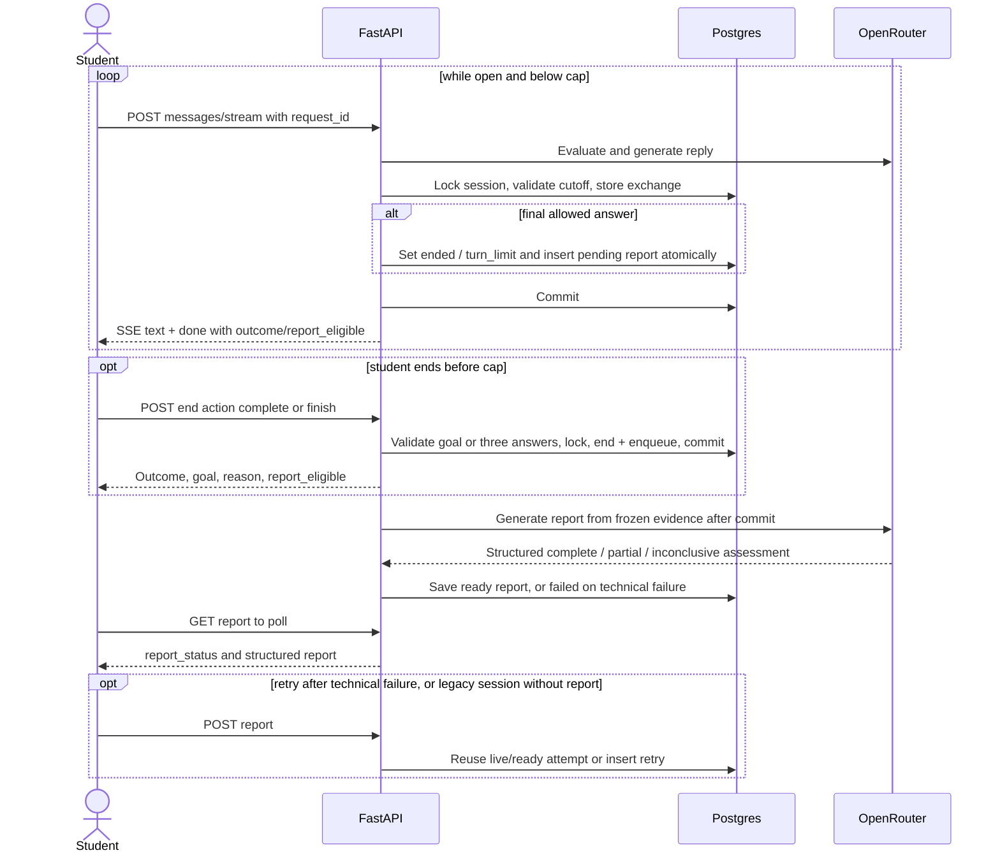

# AI backend API contract and sequences

Contract revision 7, 21 November 2026. Reconciled against PR #272 implementation `cf2c335` (including its dependency stack). Paths have the `/api/v1` prefix. This is a PR contract, not a statement that these changes are deployed.

- [PR #272 documentation preview](https://11501SoftwareEngineering.github.io/11501SoftwareEngineering-SocratesBot/pr-preview/pr-272/docs/) follows the published PR head after its docs workflow succeeds.
- [Main documentation](https://11501SoftwareEngineering.github.io/11501SoftwareEngineering-SocratesBot/docs/) follows the main deployment workflow; it does not include unmerged PR changes. Documentation deployment does not prove the backend service has been deployed.
- OpenAPI is generated from this checkout: run `python scripts/export_openapi.py -o ../docs/openapi/openapi.json` from `backend/`. The generated file is ignored by Git; CI builds it for the corresponding preview/main site. Local edits are not visible on either site until published and built.

## Authentication and error responses

Use the application's existing authentication/CSRF flow. These endpoints require an active authenticated account; 401 means authentication is required, and 403 can mean the password-change gate. Teacher-only routes additionally enforce their role/course checks. UUID/body validation returns 422 with a list under `detail`; application rejections commonly use a string under `detail`. Stage1 semantic rejection also uses 422 with a string. Do not assume every 422 has the same detail type.

Student history, reply, end and personal-report operations return **404**, not 403, for a missing or other-owner session. Session entry checks course membership separately and returns 403 for a nonmember. Setup read/save/generate/refine/opening allow the course teacher or a course TA with `edit_topics`. Publish remains restricted to the course teacher. Teaching report routes also still require the global teacher role.

## Teacher setup

| Operation | Input | Persistence and response |
| --- | --- | --- |
| POST `/courses/{courseId}/topics` | `age_band`, `max_turns`, `course_description`; optional `model_id`, `content_language` | Creates a setup topic after successful generation. Returns identifiers, setup and teacher feedback. |
| GET `/topics/{topicId}/setup` | None | Saved setup. Null-valued keys are omitted, including nested setup keys; tolerate missing optional fields. |
| POST `/topics/{topicId}/setup/generate` | `age_band`, `max_turns`, `content_language`, `course_description`, `model_id` | Returns a suggestion plus feedback. Does not save fields, language or model. The model must be in the catalog. |
| POST `/topics/{topicId}/setup/refine` | `setup`, `feedback` | Returns a suggestion plus feedback, without saving it. Uses the topic's effective model/language. |
| PUT `/topics/{topicId}/setup` | `setup`; optional `model_id`, `content_language` | Saves displayed fields and explicit selections. Omitted selections preserve stored values; null/blank selections are rejected. |
| POST `/topics/{topicId}/setup/opening-message` | `setup` | Returns **and saves** the new opening and records a revision. It does not save unrelated displayed fields. A concurrent write causes 409. |
| POST `/topics/{topicId}/publish` | `setup`; optional `model_id`, `content_language` | Saves fields/selections and publishes atomically. Invalid publication rolls back. Only age, cap, topic and core question are currently required by the publication gate; blank opening is permitted. |

Generation/refinement feedback: `assessments`, `clarification_questions`, `suggestions`, `warnings`. These are returned guidance, not separately persisted feedback. Treat missing optional response fields as unavailable. Preserve the teacher's draft on failure; the server does not durably save a rejected generation request.

Generation errors include 400 outside setup, 422 for request/semantic rejection, 502 for invalid provider output, 503 for unavailable service/incomplete substantive output, and 504 for the task timeout. See per-route OpenAPI for examples. Opening generation sends the effective content language and requests only `opening_message` using a dedicated schema (45-second timeout, at most500 output tokens). Missing/blank/malformed opening output returns502 without replacing the saved opening.

All course AI calls use the course owner's stored OpenRouter key when configured, including requests triggered by TAs/students and background report/synthesis jobs. Otherwise they use the single server OPENAI_API_KEY. Missing course/topic records or unreadable personal keys fail closed; teacher-key provider failures never switch to server billing. No rotating key pool is included. For teacher- and TA-created activities, model selection is explicit creation override → course owner (`Course.created_by`) saved default → server default. Explicit and saved selections must exist in the catalog; stale saved defaults return422. Language defaults to server configuration. These defaults affect only new topics. Generate/refine return the effective language/model; to adopt a generated selection, send it explicitly on Save/Publish. Model/language changes are recorded in inquiry revisions. No key belongs in a frontend payload, trace or example beyond the dedicated existing key-settings flow.

```mermaid
sequenceDiagram
    actor Teacher
    participant API as FastAPI
    participant Model as OpenRouter
    participant DB as Postgres
    Teacher->>API: POST /courses/{courseId}/topics
    API->>Model: Native Stage1 design request
    alt usable valid design
        API->>DB: Save setup topic and revision
        API-->>Teacher: setup and feedback
    else rejected or failed
        API-->>Teacher: 422 / 502 / 503 / 504, no new topic
    end
    Teacher->>API: POST /topics/{topicId}/setup/generate or refine
    API->>Model: Generate suggestion
    API-->>Teacher: setup and feedback, not saved
    opt opening regeneration
        Teacher->>API: POST /topics/{topicId}/setup/opening-message
        API->>Model: Generate opening
        API->>DB: Save opening and revision if not stale
        API-->>Teacher: opening_message
    end
    Teacher->>API: PUT setup or POST publish with setup and optional model/language
    API->>DB: Save; publish also enters conversation
    API-->>Teacher: Stored setup and status
```

## Session state and dialogue transport

POST `/topics/{topicId}/sessions` creates or returns the same session. Setup topics return 404; summary topics return an existing session but reject creation of a missing one with 400. Existing ended sessions are returned as ended, not reopened. The endpoint currently checks course membership, not an exclusive student course role.

The name `session_status` has two endpoint-specific meanings:

| Endpoint family | Values |
| --- | --- |
| Session entry, history, end | `open`, `completed`, `ended`, `abandoned`, `closed_by_summary` (dialogue outcome) |
| Student rows in course-topic list | `IN_PROGRESS`, `COMPLETED`, or null before entry (legacy status) |

Do not decide reply eligibility from the course-list enum. Use session history and topic stage. `open` alone does not guarantee another turn: the cap may already be spent. The opening shown in history is not a counted student turn.

POST `/sessions/{sessionId}/messages/stream` takes:

```json
{"content":"I think access matters because people need to get to work.","request_id":"11111111-1111-4111-8111-111111111111"}
```

Use authenticated POST streaming (for example, `fetch` with a stream reader); native `EventSource` does not send this POST body. Inference and persistence finish **before** the SSE response begins. Successful content type is `text/event-stream`; this is not progressive provider token streaming. Parse SSE event boundaries, not individual network chunks.

```text
data: What would change your view?
data: Consider who pays for the service.

event: done
data: {"message_id":"44444444-4444-4444-4444-444444444444","completed_turns":3,"is_completed":false,"awaiting_end_consent":true,"session_status":"open","goal_reached":true,"report_eligible":false,"ending_reason":null,"can_finish_early":true}

```

The first event is unnamed (standard event type `message`), containing the whole visible reply. Join its data lines with LF; CR/CRLF input normalizes to LF. The final named `done` event contains JSON with four required fields. OpenAPI documents the stream as a string and exposes each event schema in the `x-sse-events` response extension; it is not a JSON HTTP response. No SSE `id:` or Last-Event-ID resumption is provided.

`awaiting_end_consent=true` asks the client to offer an ending choice. It does not make the session completed or report-eligible. A new reply currently has `is_completed=false`; replay of an older committed reply can reflect a now-completed session. Replayed count/flags reflect current session state, while text/message ID identify the stored reply.

Errors before SSE starts are ordinary JSON responses: 400 closed/capped, 404 missing/other owner, 409 busy/stale/ended during generation, 413 context-budget rejection, 422 request validation, 502 model/output failure, or 503 availability/tokenizer configuration failure, plus authentication errors. Check HTTP status/content type before parsing events.

Retry the same logical submission with the same `request_id` **and content**. Once committed, its reply is replayed without another inference or stored turn. A new submission needs a new ID. A failed model turn has no durable pending student receipt; retain the draft until success and reload history after an ambiguous disconnect. The busy guard is process-local: neither cross-worker exactly-once inference nor exactly-once provider billing is guaranteed. Do not automatically retry model failures indefinitely.

## Ending and starting reports

| End action | Result |
| --- | --- |
| `complete` | Requires historical goal achievement, otherwise409. Outcome `completed`, reason `goal_reached`; enqueue report. |
| `finish` | Requires at least three stored student answers, otherwise409. Outcome `ended`, reason `student_requested_stop`; preserve goal and enqueue report. |
| `continue` | Keep `open`, clear consent, preserve achieved goal; never extend cap. |
| `abandon` | Existing behavior: outcome `abandoned`, clear goal/consent, no report. Do not use this for Finish early. |

At the final allowed student answer, the backend commits the reply, progress, outcome `ended`, reason `turn_limit`, and pending report in one transaction. It requires no subsequent end request. Report model work starts after commit. A provider failure before reply persistence leaves the answer uncommitted; retry the same request ID. Browser closure is not an ending action.

History, end and SSE done expose `report_eligible`, `ending_reason`, `can_finish_early`. SSE also exposes `session_status` and `goal_reached`. Use outcome/report_eligible to navigate, NOT is_completed alone: is_completed retains its completed-outcome meaning, and is false for ended sessions. At the cap consent is false even when the goal was achieved. End/history/SSE all preserve historical goal achievement. `ended_at` records any report-producing end; `completed_at` retains successful completion semantics. Report completion_reason is goal_reached/student_requested_stop/turn_limit (legacy completed remains readable).

Repeated same terminal action returns200 without enqueuing another attempt. Finish after cap returns the existing ended result. Conflicting terminal actions return409. The session row lock serializes end and reply persistence across workers; if end wins, an in-flight model result cannot append to the closed transcript. Same-process busy replies return409. This does not guarantee exactly-once model billing.



GET report never starts generation. It returns409 for ineligible outcomes,404 for no attempt (possible for legacy sessions), and200 with pending/processing/ready/failed otherwise. New report-producing endings enqueue automatically. POST remains the recovery/reuse endpoint. Inconclusive is a valid ready report, not a technical failure: evidence_status=insufficient, with observed evidence and limitations. Prefer useful partial summaries whenever possible; no goal achievement or milestone requirement gates report generation.

| Newest attempt at POST | Behavior |
| --- | --- |
| None | Insert pending attempt, snapshot progress and schedule |
| Pending/processing with unexpired lease | Reuse |
| Ready | Reuse; not forced regeneration |
| Failed or expired pending/processing | Insert and schedule a new attempt |

Teacher POST `/topics/{topicId}/reports/{sessionId}` uses the same retry/reuse rules, except that a ready report with missing/invalid native evidence or a mismatched inquiry can be regenerated for Stage3 compatibility. A valid native ready report is reused. It is not “always generate another report.” Snapshot refresh occurs only on insertion. A latest failed/running attempt may coexist with an older ready body: `report_status` describes the newest attempt, while `report` is the latest available ready body or null. Stop normal polling on ready/failed and present appropriate recovery; no fixed server polling interval is promised.

```json
{"report_status":"pending","report":null}
```

Reports retain validated timeline citations and private native summaries from Chunk05. Reports expose server ending metadata and goal_reached separately; anonymous_id remains undefined. Teaching counts retain completed_count for successful completion and add ended_count for early/cap endings. Ready/failed counts include both. Native Stage3 is included below. Per-student group tags are not returned by the teaching report list.

## Scope and verification

Chunk06 adds lifecycle, migration, automatic enqueue, evidence policy and API documentation. Local mock tests do not establish real-Postgres concurrency or live-model summary quality. See the chunk handoff for validation and deployment prerequisites.

## Dialogue contract repairs (Chunk04)

`goal_reached` is historical eligibility to complete, not the latest model's milestone state. Continue preserves it. After another saved reply, including an off-topic reply, the stored ending-choice flag and SSE done flag agree and offer completion again when eligibility was already achieved. History returns `current_progress` separately; its milestones may regress without erasing achievement. Chunk06 adds the ending behavior above.

The planner receives `approvedInquiryBrief`, `interfaceLanguage`, and `dialogueRecord`; the brief includes the turn cap. Context compaction budgets this actual envelope and planner schema. Validity, status, planning and legacy catch-up each check their request schema/material/output reserve before their provider call. Oversized requests return413; missing tokenizer support returns503. Legacy catch-up fails explicitly on oversized history rather than silently truncating evidence.

Progress references must identify an existing positive student exchange. Invalid or future references are rejected as model output errors before persistence; structural references alone do not prove that the cited text supports the claim.


## Default model selection

The configured defaults for `OPENAI_MODEL` and `OPENAI_VALIDITY_MODEL` are `openai/gpt-6.1-sol`, as selected by the project owner. Existing environment overrides still win. Saved teacher/topic selections also remain unchanged. Validity, status, planning, context compression, progress catch-up, personal reports and class synthesis use the saved activity model, falling back to OPENAI_MODEL only when absent. OPENAI_VALIDITY_MODEL remains accepted for configuration compatibility but no longer controls course dialogue. New report source snapshots and summary requests retain the resolved model; legacy pending snapshots acquire it once from their topic. Credentials are looked up at execution and never frozen in evidence/attempt JSON. This is configuration compatibility with the existing catalog/tokenizer mapping, not a live OpenRouter availability or output-quality certification.


## Native individual reports (Chunk05)

Personal report generation now sends `interfaceLanguage`, the approved inquiry brief, a numbered `transcript`, the attempt's `finalProgress`, and truthful `endingReason`. The owned report-eligible dialogue is snapshotted and committed before the model call. A fingerprint binds the saved input to the stored native summary; model/prompt versions are recorded. The native summary and source stay in private attempt metadata, outside student/teaching report bodies. Class synthesis privately consumes the validated native evidence.

The provider schema matches the native lab's outcome/workingPosition/strongestReason/challengeExamined/revisionOrDefence/focalTensionConnection/remainingQuestion/reflection/unmetElements fields. Native `outcome` describes the evidence result, not backend dialogue termination or job status. A partial/insufficient-evidence result can be a successfully generated ready report. Both `completed` and `ended` dialogues are report-eligible; `abandoned` is not.

Public report keys remain compatible. Reflection/working position, strongest reason, revision, focus connection, remaining question and limitations map to their existing fields. `viewpoint_status`, `other_perspectives`, and timeline viewpoint/change fields stay empty when the native contract cannot establish them. `challenges.responded` uses validated examination/response progress rather than an invented boolean. Timeline is a chronological student-evidence index, not a claim about causal changes in belief. `attribution=none` means no change attribution is made.

New timeline items retain string `evidence` and add `evidence_reference: {message_id, turn, quote}`. Quotes are copied from stored student messages; the validator checks ownership-derived source, turn, ID, question and exact quote, and rejects duplicates/malformed entries. This checks source integrity, not whether every model interpretation is philosophically or semantically justified. Legacy stored reports remain readable but are not retroactively certified.

`completed_at`, when available, comes from the session's server timestamp. `anonymous_id` remains unimplemented pending an agreed alias scope; clients must not assume it exists. Reports larger than `REPORT_CONTEXT_TOKEN_BUDGET` (default32000 estimated request tokens including output reserve) fail before provider invocation rather than silently dropping evidence. This is a configurable local guard, not a guarantee of provider context capacity. Existing retry/poll behavior remains. Native Stage3 consumes these saved sources as described below.


### Model and credential routing (combined Chunk07/08)

```mermaid
sequenceDiagram
    participant Caller as Teacher / TA / Student / Job
    participant API as Backend
    participant DB as Postgres
    participant Model as OpenRouter
    Caller->>API: Existing course operation
    API->>DB: Authorize operation; load course owner and activity
    API->>API: Resolve saved model (or explicit Stage1 generation override)
    API->>DB: Load course owner's encrypted credential
    alt Personal credential exists and can be decrypted
        API->>Model: Selected model + personal credential
    else No personal credential configured
        API->>Model: Selected model + single server credential
    end
    Model-->>API: Result or failure (no billing-account failover)
    API->>DB: Validated result and nonsecret provenance
    API-->>Caller: Existing response / job status
```

An unreadable credential or missing ownership record stops before a provider request. Model failures preserve existing API error/job-failure contracts. There are no new request fields or frontend changes. Summary model/language are captured when enqueued; report model is captured with its source before inference. Retrying an existing captured request retains its model; a new attempt may resolve current configuration. Native Stage3 uses the same model and credential routing.


## Native Stage3 class synthesis

Individual reports are queued at each qualifying dialogue ending and are immediately readable by their owner when ready. They do not wait for class synthesis or teacher publication.

POST `/topics/{topicId}/summary` requires **all existing dialogues for that topic to be non-open**, and the **latest attempt for every report-eligible dialogue (`completed` or `ended`) to be ready**. Pending, processing, failed or missing personal reports block with409; an older ready result does not bypass a newer failed/pending attempt. Abandoned and historical closed_by_summary sessions are not report-eligible and are not in the denominator. Students who never entered a session are not counted as open dialogues.

Ready reports without matching native summary/source evidence must be regenerated using the existing teacher report retry endpoint. Source-digest or inquiry-setting mismatches return409 rather than silently omitting records or fabricating evidence. No ready cohort returns400. More than50 reports or an oversized payload/model request returns413. Unsupported model tokenization returns503. There is no automatic batching or truncation.

A summary attempt freezes the selected report IDs, session IDs, source digests, converted native arguments, language and activity model. Model material contains temporary labels and evidence-grounded argument summaries, not raw transcripts or database IDs. The model proposes groups based on positions and reasons, with shared values, assumptions, internal differences and discussion questions. Backend validation rejects duplicate, unknown or ineligible membership and computes all counts/percentages. Inconclusive and unassigned reports remain in the denominator and appear as ungrouped in the existing public DTO; privately they form Still exploring. If all reports are unclassifiable, the backend creates an honest deterministic summary without calling the provider.

During a live pending/processing summary lease, new session creation returns409; existing sessions remain readable. Topic locking serializes entry and synthesis. At ready commit, the backend rechecks open sessions and selected report IDs; a changed cohort fails the attempt instead of closing new dialogues or publishing a stale cohort. Failed/expired jobs do not permanently block session entry. Topic stage changes to summary only on successful ready commit. **Synthesis no longer changes open sessions to closed_by_summary.**

Native results and source mappings remain private in attempt/version JSON. Existing teacher `overview`/`viewpoint_summary` fields contain the projected native content; existing groups/count fields remain unchanged. Text edits retain private provenance and invalidate review. Publish uses the latest reviewed version and excludes private fields; regeneration preserves an existing published version until explicit replacement. Known names/identifiers and generated temporary-label leakage are checked, but this is not a guarantee of perfect anonymity or correct philosophical interpretation. Teacher review remains necessary.

Legacy pending summary requests from the old schema fail safely and must be restarted through POST summary. Existing published summaries remain readable. No database migration or frontend changes are required.

```mermaid
sequenceDiagram
    participant Student
    participant API as Backend
    participant DB as Postgres
    participant Model as OpenRouter
    participant Teacher
    Student->>API: Complete / finish early / final allowed answer
    API->>DB: End this dialogue and queue personal report
    API-->>Student: Ending response (report queued)
    Note over API,Model: Background personal-report job
    API->>Model: Generate personal report
    API->>DB: Store ready report
    Student->>API: GET own report (no class wait)
    Teacher->>API: POST topic summary
    API->>DB: Lock topic; check no open dialogues and every eligible report ready
    alt Open dialogue or missing/failed/incompatible report
        API-->>Teacher: 409 with recovery instruction
    else Cohort ready and within limits
        API->>DB: Freeze native cohort; queue synthesis
        API-->>Teacher: 200 preparation_status=pending, summary=null
        Note over API,DB: Background job; new session entry blocked during active lease
        alt At least one classifiable report
            API->>Model: Inquiry, language, temporary report labels and arguments
            Model-->>API: Qualitative groups and discussion material
        else All reports unclassifiable
            API->>API: Deterministic insufficient-evidence result
        end
        API->>API: Validate membership and compute counts
        API->>DB: Recheck cohort; save private native draft; topic becomes summary
        Teacher->>API: GET summary (poll preparation_status)
        API-->>Teacher: ready + draft, or failed (previous publication preserved)
        Teacher->>API: Edit / review / publish exact version
        Student->>API: GET published class summary
        API-->>Student: Anonymous aggregate projection
    end
```


## API change log and caller migration guide

This guide describes the accumulated AI/backend stack (PRs260–264,267,268,272), with implementation verified at `cf2c335` and published documentation corrections at `459b816`. It is a change/adoption guide, not a claim that every listed endpoint is newly introduced: many existing paths retain their public shape while their behavior is repaired. This expanded guide is a documentation follow-up on the same PR branch; publication does not imply backend deployment. All paths below are relative to `/api/v1`.

### 1. Stage1: setup generation and persistence

| Endpoint | Changed or clarified contract | Caller action |
|---|---|---|
| POST `/courses/{courseId}/topics` | Optional `model_id` and `content_language`. Model fallback uses the course owner's saved default, including when a TA creates the topic, then server default. Invalid catalog selections/defaults return422. Creation waits for valid generation before persisting the topic. | Send explicit selections when overriding defaults. Preserve the entered draft after an error. |
| GET `/topics/{topicId}/setup` | Optional null-valued fields can be omitted, including nested setup fields. | Do not require every optional key to exist. |
| POST `/topics/{topicId}/setup/generate` | Returns generated setup and feedback plus effective model/language. Generation does not save the proposed setup or model/language. | Present the suggestion for adoption; send its selections on Save/Publish. |
| POST `/topics/{topicId}/setup/refine` | Returns an unsaved suggestion from `setup` and `feedback`, using the topic's effective model/language. | Do not treat refinement success as a durable save. |
| PUT `/topics/{topicId}/setup` | Accepts `setup` and optional `model_id`, `content_language`. Omission preserves stored selections; explicit null/blank is rejected. | Include changed selections explicitly, alongside the displayed setup. |
| POST `/topics/{topicId}/publish` | Same explicit selection persistence, with save and publication in one transaction. Publication remains teacher-only. | Handle validation failure without assuming any partial save. |
| POST `/topics/{topicId}/setup/opening-message` | Dedicated opening-only model output; effective language supplied. Saves only the generated opening and its revision. Concurrent edits return409; invalid opening returns502 without overwriting the prior one. | Replace the opening only after success. Do not assume other displayed setup edits were saved. |

Setup read/save/generation/refinement/opening support the course teacher and authorized TA (`edit_topics`). This permission change does not grant TAs the teacher-only report/summary APIs. Feedback fields are `assessments`, `clarification_questions`, `suggestions`, `warnings`; feedback is guidance, not separately saved content. Stage1 request/semantic validation can return422, provider output502, service/substantive availability503, timeout504, and non-setup operations400. Authentication and ownership checks still apply.

### 2. Stage2: session entry, history and SSE

No direct frontend-to-model integration is needed. Frontend submits answers to the backend; backend owns inference, evidence validation and persistence.

| Endpoint | Change / actual behavior |
|---|---|
| POST `/topics/{topicId}/sessions` | Reuses this student's existing session without reopening it. A new session is refused with409 while a summary attempt has an active lease. Existing sessions remain retrievable. New entry after topic stage `summary` returns400; setup is hidden with404. |
| GET `/sessions/{sessionId}/messages` | Includes historical `goal_reached` and separate `current_progress`. Also exposes `report_eligible`, `ending_reason`, `can_finish_early`. Current milestones may regress without erasing previously earned completion eligibility. |
| POST `/sessions/{sessionId}/messages/stream` | Request remains `content` (nonblank, at most6000 characters) and `request_id`. One unnamed SSE text event precedes named `done`; inference finishes before SSE begins. `done` includes lifecycle fields below. |

The complete `done` payload has `message_id`, `completed_turns`, `is_completed`, `awaiting_end_consent`, `session_status`, `goal_reached`, `report_eligible`, `ending_reason`, `can_finish_early`. `current_progress` is available from history, not part of the SSE done schema. Reply text is in the unnamed event, not a JSON `text` field in done.

| Field | Meaning / integration consequence |
|---|---|
| `session_status` | Actual dialogue outcome: `open`, `completed`, `ended`, `abandoned`, legacy `closed_by_summary`. Do not confuse it with course-list legacy status labels. |
| `goal_reached` | Historical achievement, preserved through Continue and report-producing endings. It is not equivalent to the newest progress snapshot. |
| `awaiting_end_consent` | Offer the end/continue decision. It is not a server-enforced requirement to submit that decision before another reply. |
| `is_completed` | True only for outcome `completed`; an `ended` session can have a report while this remains false. |
| `report_eligible` | Whether this ending permits a report. It is not report readiness. Poll the report endpoint separately. |
| `can_finish_early` | Server-computed eligibility for explicit early finish; do not count the opening as a student answer. |
| `ending_reason` | `goal_reached`, `student_requested_stop`, `turn_limit`, or null when no such ending applies. |

Pre-stream errors are ordinary JSON, not SSE:400 closed/capped or invalid topic phase;404 missing/non-owned session;409 busy/stale state;413 context budget;422 bad request;502 model/output failure;503 unavailable service/tokenizer. For ambiguous network failures, reload history and retry the same logical answer using the same request ID and content. Committed answers replay; a new answer needs a new ID. This does not promise exactly-once provider billing across workers or failures.

### 3. Ending: actions, outcomes and automatic reporting

POST `/sessions/{sessionId}/end` accepts `{"action":"complete"}`, `continue`, `finish`, or `abandon`.

| Action/event | Preconditions | Stored outcome | Report behavior |
|---|---|---|---|
| `complete` | Goal eligibility achieved | `completed`; reason `goal_reached` | Pending report queued atomically with ending |
| `continue` | Dialogue still accepts this action | Remains `open`; consent cleared, achievement retained | No ending/report yet; cap unchanged |
| `finish` | At least three stored student answers | `ended`; reason `student_requested_stop` | Pending report queued, regardless of goal achievement |
| Final allowed answer | Reply successfully persisted at cap | `ended`; reason `turn_limit` | Automatic backend ending and report enqueue; no extra end POST required |
| `abandon` | Existing abandon action | `abandoned` | No report; do not use for the report-producing Finish early flow |
| Browser closure | No API ending | Unchanged | Does not automatically end or queue a report |

End responses contain `session_id`, `session_status`, `message`, `goal_reached`, `report_eligible`, `ending_reason`, `can_finish_early`. Insufficient turns for finish or missing goal for complete returns409. Same terminal action is idempotent; incompatible terminal action returns409. Finish after automatic cap ending returns the existing ended result. Malformed action returns422; missing/non-owned session404.

Caller flow: show end/continue on consent; offer early finish when eligible; after done/end reports an eligible ending, navigate to personal-report polling even if `goal_reached=false` or `is_completed=false`.

### 4. Personal reports: eligibility, content and recovery

| Endpoint | Contract |
|---|---|
| GET `/sessions/{sessionId}/report` | Owner-only read. Does not start generation. 200 contains `report_status` and `report`;409 ineligible outcome;404 missing/non-owned session or no attempt yet. |
| POST `/sessions/{sessionId}/report` | Owner-only recovery/start. Reuses a ready attempt or a live pending/processing attempt. Missing, failed or expired attempt starts a new one. It is not an unconditional regenerate operation. |
| POST `/topics/{topicId}/reports/{sessionId}` | Teacher/instructor recovery, with the additional ability to regenerate ready reports that lack valid native evidence or no longer match the inquiry. Compatible ready reports are reused. |
| GET `/topics/{topicId}/reports` | Teacher/instructor list. Includes `class_size`, `completed_count`, new `ended_count`, `ready_count`, `processing_count`, `failed_count`, and `reports` items containing `report_status`, `report`, `student_display_name`. |

Both `completed` and `ended` are eligible; abandoned/historical closed-by-summary sessions are not. `report_status` is `pending`, `processing`, `ready` or `failed`. Latest status and latest available ready body are separate: a failed/rebuilding attempt may accompany an older readable report. Stop routine polling at ready/failed; use POST for appropriate recovery.

Report content preserves the existing projection: `viewpoint_summary`, `final_viewpoint`, `viewpoint_status`, `reasons`, `strongest_reason`, `challenges`, `revision_or_defense`, `focus_connection`, `other_perspectives`, `open_questions`, `evidence_status`, `limitations`, `timeline`, plus report/session/topic identifiers and version/turn metadata. Optional or unsupported fields may be absent or empty; do not invent defaults that imply evidence.

Additions/clarifications:

- `ended_at` records a report-producing end; `completed_at` retains successful-completion meaning. `goal_reached` is independent of report readiness.
- `completion_reason` reflects goal achievement, explicit early stop or turn limit. Legacy `completed` values remain readable.
- `evidence_status`: `sufficient`, `partial`, `insufficient`. Insufficient evidence is a valid **ready structured report**, with useful supported observations and limitations; it is not automatically a failed job or a one-line replacement for the report.
- New timeline items preserve `evidence` and add `evidence_reference` with `message_id`, `turn`, `quote`, checked against stored student messages. Legacy items remain readable without retroactive validation.
- Native summary/source/provenance stay private. `anonymous_id` is not guaranteed. The teaching report list does not supply per-student `group_ids`, a group catalog or `summary_version`.
- Students may read their ready personal report immediately; teacher publication applies to the class summary, not personal reports.

### 5. Stage3: stricter readiness, background synthesis, same public projection

POST `/topics/{topicId}/summary` remains the synthesis entry point. It now requires all existing topic dialogues non-open and the latest report attempt for **every** completed/ended session ready with compatible native evidence. A never-started student does not count as an open dialogue. An older ready body does not bypass a newer failed/pending attempt. Abandoned/historical closed-by-summary sessions are excluded. Ready inconclusive reports are included in the denominator.

A successful enqueue/reuse returns HTTP200, for example:

```json
{
  "topic_status": "conversation",
  "published_version": null,
  "summary": null,
  "preparation_status": "pending"
}
```

This is not a completed draft. Existing topic/publication state can differ during regeneration. Poll GET `/topics/{topicId}/summary`: `preparation_status` reports pending/processing/ready/failed (null without an attempt); `summary` is the available stored version, and `published_version` independently identifies the student-visible version. Topic changes to summary only when a ready draft is committed. Background failures appear as failed status, not a retroactive HTTP error on the original POST.

| Start error | Meaning / recovery |
|---|---|
|400|Topic still setup or no eligible ready cohort; correct the phase/cohort first.|
|403/404|Role/course access denied or topic missing; summary routes currently require global teacher plus course instructor membership, not general TA permissions.|
|409|Open dialogue, missing/nonready latest report, or incompatible native evidence. End dialogues, wait/retry reports, or use teacher report regeneration as appropriate.|
|413|More than50 reports, more than180000 model-material bytes, or configured request/output token budget exceeded. No silent truncation or batching.|
|422|Request/path validation.|
|503|Configured model tokenizer unsupported before enqueue.|

The backend freezes source versions, rejects invalid group membership, computes counts/percentages itself, and rechecks cohort validity before saving. An all-unclassifiable cohort produces an honest deterministic result without a provider call. There is no longer an automatic close-all-dialogues step in synthesis. Failed/expired leases stop blocking new entry; successful synthesis moves the topic to summary, where normal new-entry restrictions apply.

Teacher draft structure remains `summary_id`, `version`, `summary_status`, `overview`, `viewpoint_summary`, `denominator`, `groups` (`group_id`, `name`, `conditions`, `count`, `percentage`, `report_ids`), `ungrouped_report_ids`. Rich native arguments/discussion material are retained privately and projected into existing text fields; there is no new public native-synthesis object.

Existing publication paths remain:

| Endpoint | Request / behavior |
|---|---|
| GET `/topics/{topicId}/summary?version=N` | Optional positive version;404 when that version does not exist. Without version, reads latest stored draft and job state. |
| PATCH `/topics/{topicId}/summary` | `overview`, `viewpoint_summary`; changed text produces a new draft version and invalidates review for that version. |
| POST `/topics/{topicId}/summary/review` | Same text fields; stores changed text then marks that version reviewed. |
| POST `/topics/{topicId}/summary/publish` | No body; publishes latest version only if reviewed. A newer unreviewed draft returns400, even if an older version was reviewed. |
| POST `/topics/{topicId}/summary/withdraw` | No body; removes student visibility of the publication. |
| GET `/topics/{topicId}/summary/published` | Course-member read of anonymous aggregate, or `summary:null` without publication. No report IDs/private native sources in the response. |

Published aggregate fields remain `overview`, `viewpoint_summary`, `groups` (`name`, `conditions`, `count`, `percentage`), `ungrouped_count`, `ungrouped_percentage`, `denominator`. Ungrouped reports count in the denominator. Regenerating/editing a draft does not remove a previously published view. Teacher review is still needed for interpretation and potentially identifying prose.

### 6. Configuration changes, rollout and validation boundaries

Teacher-selected model is used consistently across dialogue tasks, personal reports and class synthesis. Default model is `openai/gpt-6.1-sol` absent explicit/saved/environment overrides. `OPENAI_VALIDITY_MODEL` remains accepted for configuration compatibility but no longer selects a separate course-dialogue validity model. Report/synthesis attempts capture the selected model; credentials are resolved at execution and never stored in public evidence.

Course owner's personal credential takes priority; otherwise the single server credential is used. No new credential fields are required in these frontend calls, no teacher-to-server failover occurs after provider failure, and no rotating key pool is included (PR266 deferred).

Rollout must include the Chunk06 database migration for the new ending lifecycle; native Stage3 uses existing JSON storage and introduces no additional migration. Keep frontend outcome handling compatible with `ended`, poll job status independently from dialogue/goal state, and account for stricter Stage3 readiness and the temporary409 new-entry gate. Verify the deployed backend schema before adopting PR documentation.

Evidence: implementation `cf2c335` passed584 API/unit/migration checks and32 real-Postgres integration tests. Documentation correction `459b816` passed12 focused export/example checks locally and SonarCloud remotely. This expanded guide changes prose only; no new runtime behavior or live-model quality claim. The full HTTP acceptance journey and latest preview deployment verification remain separate outstanding work.
