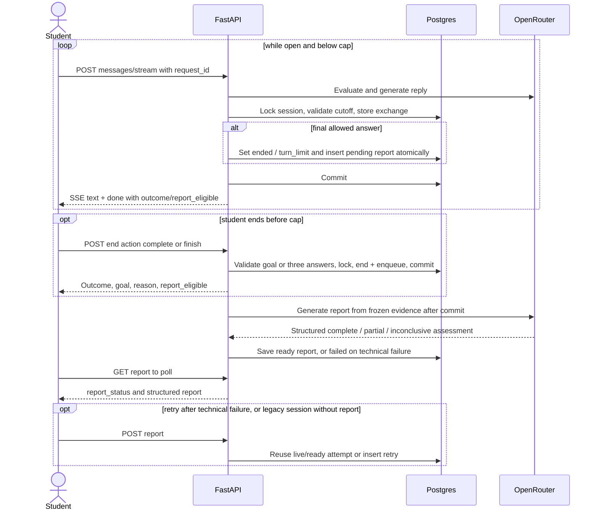

# AI backend API contract and sequences

Contract revision 6, 21 November 2026. Local Chunk06 candidate on Chunk05 plus main59efe44. Early-stop/cap/report changes below are implemented locally and require review, migration and deployment before frontend adoption. Paths have the `/api/v1` prefix. Use OpenAPI from the same revision.

## Authentication and error responses

Use the application's existing authentication/CSRF flow. These endpoints require an active authenticated account; 401 means authentication is required, and 403 can mean the password-change gate. Teacher-only routes additionally enforce their role/course checks. UUID/body validation returns 422 with a list under `detail`; application rejections commonly use a string under `detail`. Stage1 semantic rejection also uses 422 with a string. Do not assume every 422 has the same detail type.

Student history, reply, end and personal-report operations return **404**, not 403, for a missing or other-owner session. Session entry checks course membership separately and returns 403 for a nonmember. Setup read/save/generate/refine/opening allow the course teacher or a course TA with `edit_topics`. Publish remains restricted to the course teacher. Teaching report routes also still require the global teacher role.

## Teacher setup

| Operation | Input | Persistence and response |
| --- | --- | --- |
| POST `/courses/{courseId}/topics` | `age_band`, `max_turns`, `course_description`; optional `model_id`, `content_language` | Creates a setup topic after successful generation. Returns identifiers, setup and teacher feedback. |
| GET `/topics/{topicId}/setup` | None | Saved setup. Null-valued keys are omitted, including nested setup keys; tolerate missing optional fields. |
| POST `/topics/{topicId}/setup/generate` | `age_band`, `max_turns`, `content_language`, `course_description`, `model_id` | Returns a suggestion plus feedback. Does not save fields, language or model. The model must be in the catalog. |
| POST `/topics/{topicId}/setup/refine` | `setup`, `feedback` | Returns a suggestion plus feedback, without saving it. Uses the topic's effective model/language. |
| PUT `/topics/{topicId}/setup` | `setup`; optional `model_id`, `content_language` | Saves displayed fields and explicit selections. Omitted selections preserve stored values; null/blank selections are rejected. |
| POST `/topics/{topicId}/setup/opening-message` | `setup` | Returns **and saves** the new opening and records a revision. It does not save unrelated displayed fields. A concurrent write causes 409. |
| POST `/topics/{topicId}/publish` | `setup`; optional `model_id`, `content_language` | Saves fields/selections and publishes atomically. Invalid publication rolls back. Only age, cap, topic and core question are currently required by the publication gate; blank opening is permitted. |

Generation/refinement feedback: `assessments`, `clarification_questions`, `suggestions`, `warnings`. These are returned guidance, not separately persisted feedback. Treat missing optional response fields as unavailable. Preserve the teacher's draft on failure; the server does not durably save a rejected generation request.

Generation errors include 400 outside setup, 422 for request/semantic rejection, 502 for invalid provider output, 503 for unavailable service/incomplete substantive output, and 504 for the task timeout. See per-route OpenAPI for examples. Opening generation sends the effective content language and requests only `opening_message` using a dedicated schema (45-second timeout, at most500 output tokens). Missing/blank/malformed opening output returns502 without replacing the saved opening.

Stage1 uses the requesting user's stored OpenRouter key when available, otherwise the server key. Dialogue/report calls use server credentials. Configuring only a teacher key does not establish access for all stages. For teacher- and TA-created activities, model selection is explicit creation override → course owner (`Course.created_by`) saved default → server default. Explicit and saved selections must exist in the catalog; stale saved defaults return422. Language defaults to server configuration. These defaults affect only new topics. Generate/refine return the effective language/model; to adopt a generated selection, send it explicitly on Save/Publish. Model/language changes are recorded in inquiry revisions. No key belongs in a frontend payload, trace or example beyond the dedicated existing key-settings flow.

```mermaid
sequenceDiagram
    actor Teacher
    participant API as FastAPI
    participant Model as OpenRouter
    participant DB as Postgres
    Teacher->>API: POST /courses/{courseId}/topics
    API->>Model: Native Stage1 design request
    alt usable valid design
        API->>DB: Save setup topic and revision
        API-->>Teacher: setup and feedback
    else rejected or failed
        API-->>Teacher: 422 / 502 / 503 / 504, no new topic
    end
    Teacher->>API: POST /topics/{topicId}/setup/generate or refine
    API->>Model: Generate suggestion
    API-->>Teacher: setup and feedback, not saved
    opt opening regeneration
        Teacher->>API: POST /topics/{topicId}/setup/opening-message
        API->>Model: Generate opening
        API->>DB: Save opening and revision if not stale
        API-->>Teacher: opening_message
    end
    Teacher->>API: PUT setup or POST publish with setup and optional model/language
    API->>DB: Save; publish also enters conversation
    API-->>Teacher: Stored setup and status
```

## Session state and dialogue transport

POST `/topics/{topicId}/sessions` creates or returns the same session. Setup topics return 404; summary topics return an existing session but reject creation of a missing one with 400. Existing ended sessions are returned as ended, not reopened. The endpoint currently checks course membership, not an exclusive student course role.

The name `session_status` has two endpoint-specific meanings:

| Endpoint family | Values |
| --- | --- |
| Session entry, history, end | `open`, `completed`, `ended`, `abandoned`, `closed_by_summary` (dialogue outcome) |
| Student rows in course-topic list | `IN_PROGRESS`, `COMPLETED`, or null before entry (legacy status) |

Do not decide reply eligibility from the course-list enum. Use session history and topic stage. `open` alone does not guarantee another turn: the cap may already be spent. The opening shown in history is not a counted student turn.

POST `/sessions/{sessionId}/messages/stream` takes:

```json
{"content":"I think access matters because people need to get to work.","request_id":"11111111-1111-4111-8111-111111111111"}
```

Use authenticated POST streaming (for example, `fetch` with a stream reader); native `EventSource` does not send this POST body. Inference and persistence finish **before** the SSE response begins. Successful content type is `text/event-stream`; this is not progressive provider token streaming. Parse SSE event boundaries, not individual network chunks.

```text
data: What would change your view?
data: Consider who pays for the service.

event: done
data: {"message_id":"44444444-4444-4444-4444-444444444444","completed_turns":1,"is_completed":false,"awaiting_end_consent":true}

```

The first event is unnamed (standard event type `message`), containing the whole visible reply. Join its data lines with LF; CR/CRLF input normalizes to LF. The final named `done` event contains JSON with four required fields. OpenAPI documents the stream as a string and exposes each event schema in the `x-sse-events` response extension; it is not a JSON HTTP response. No SSE `id:` or Last-Event-ID resumption is provided.

`awaiting_end_consent=true` asks the client to offer an ending choice. It does not make the session completed or report-eligible. A new reply currently has `is_completed=false`; replay of an older committed reply can reflect a now-completed session. Replayed count/flags reflect current session state, while text/message ID identify the stored reply.

Errors before SSE starts are ordinary JSON responses: 400 closed/capped, 404 missing/other owner, 409 busy/stale/ended during generation, 413 context-budget rejection, 422 request validation, 502 model/output failure, or 503 availability/tokenizer configuration failure, plus authentication errors. Check HTTP status/content type before parsing events.

Retry the same logical submission with the same `request_id` **and content**. Once committed, its reply is replayed without another inference or stored turn. A new submission needs a new ID. A failed model turn has no durable pending student receipt; retain the draft until success and reload history after an ambiguous disconnect. The busy guard is process-local: neither cross-worker exactly-once inference nor exactly-once provider billing is guaranteed. Do not automatically retry model failures indefinitely.

## Ending and starting reports

| End action | Result |
| --- | --- |
| `complete` | Requires historical goal achievement, otherwise409. Outcome `completed`, reason `goal_reached`; enqueue report. |
| `finish` | Requires at least three stored student answers, otherwise409. Outcome `ended`, reason `student_requested_stop`; preserve goal and enqueue report. |
| `continue` | Keep `open`, clear consent, preserve achieved goal; never extend cap. |
| `abandon` | Existing behavior: outcome `abandoned`, clear goal/consent, no report. Do not use this for Finish early. |

At the final allowed student answer, the backend commits the reply, progress, outcome `ended`, reason `turn_limit`, and pending report in one transaction. It requires no subsequent end request. Report model work starts after commit. A provider failure before reply persistence leaves the answer uncommitted; retry the same request ID. Browser closure is not an ending action.

History, end and SSE done expose `report_eligible`, `ending_reason`, `can_finish_early`. SSE also exposes `session_status` and `goal_reached`. Use outcome/report_eligible to navigate, NOT is_completed alone: is_completed retains its completed-outcome meaning, and is false for ended sessions. At the cap consent is false even when the goal was achieved. End/history/SSE all preserve historical goal achievement. `ended_at` records any report-producing end; `completed_at` retains successful completion semantics. Report completion_reason is goal_reached/student_requested_stop/turn_limit (legacy completed remains readable).

Repeated same terminal action returns200 without enqueuing another attempt. Finish after cap returns the existing ended result. Conflicting terminal actions return409. The session row lock serializes end and reply persistence across workers; if end wins, an in-flight model result cannot append to the closed transcript. Same-process busy replies return409. This does not guarantee exactly-once model billing.



GET report never starts generation. It returns409 for ineligible outcomes,404 for no attempt (possible for legacy sessions), and200 with pending/processing/ready/failed otherwise. New report-producing endings enqueue automatically. POST remains the recovery/reuse endpoint. Inconclusive is a valid ready report, not a technical failure: evidence_status=insufficient, with observed evidence and limitations. Prefer useful partial summaries whenever possible; no goal achievement or milestone requirement gates report generation.

| Newest attempt at POST | Behavior |
| --- | --- |
| None | Insert pending attempt, snapshot progress and schedule |
| Pending/processing with unexpired lease | Reuse |
| Ready | Reuse; not forced regeneration |
| Failed or expired pending/processing | Insert and schedule a new attempt |

Teacher POST `/topics/{topicId}/reports/{sessionId}` uses the same retry/reuse rules. It is not “always generate another report.” Snapshot refresh occurs only on insertion. A latest failed/running attempt may coexist with an older ready body: `report_status` describes the newest attempt, while `report` is the latest available ready body or null. Stop normal polling on ready/failed and present appropriate recovery; no fixed server polling interval is promised.

```json
{"report_status":"pending","report":null}
```

Reports retain validated timeline citations and private native summaries from Chunk05. Reports expose server ending metadata and goal_reached separately; anonymous_id remains undefined. Teaching counts retain completed_count for successful completion and add ended_count for early/cap endings. Ready/failed counts include both. Group tags and full native Stage3 synthesis remain a later chunk.

## Scope and verification

Chunk06 adds lifecycle, migration, automatic enqueue, evidence policy and API documentation. Local mock tests do not establish real-Postgres concurrency or live-model summary quality. See the chunk handoff for validation and deployment prerequisites.

## Dialogue contract repairs (Chunk04)

`goal_reached` is historical eligibility to complete, not the latest model's milestone state. Continue preserves it. After another saved reply, including an off-topic reply, the stored ending-choice flag and SSE done flag agree and offer completion again when eligibility was already achieved. History returns `current_progress` separately; its milestones may regress without erasing achievement. Chunk06 adds the ending behavior above.

The planner receives `approvedInquiryBrief`, `interfaceLanguage`, and `dialogueRecord`; the brief includes the turn cap. Context compaction budgets this actual envelope and planner schema. Validity, status, planning and legacy catch-up each check their request schema/material/output reserve before their provider call. Oversized requests return413; missing tokenizer support returns503. Legacy catch-up fails explicitly on oversized history rather than silently truncating evidence.

Progress references must identify an existing positive student exchange. Invalid or future references are rejected as model output errors before persistence; structural references alone do not prove that the cited text supports the claim.


## Default model selection

The configured defaults for `OPENAI_MODEL` and `OPENAI_VALIDITY_MODEL` are `openai/gpt-6.1-sol`, as selected by the project owner. Existing environment overrides still win. Saved teacher/topic selections also remain unchanged. Validity uses its separate configured model; reports and class synthesis use the global default. This is configuration compatibility with the existing catalog/tokenizer mapping, not a live OpenRouter availability or output-quality certification.


## Native individual reports (Chunk05)

Personal report generation now sends `interfaceLanguage`, the approved inquiry brief, a numbered `transcript`, the attempt's `finalProgress`, and truthful `endingReason`. The owned completed dialogue is snapshotted and committed before the model call. A fingerprint binds the saved input to the stored native summary; model/prompt versions are recorded. The native summary and source stay in private attempt metadata, outside student/teaching report bodies and existing class-summary request bodies.

The provider schema matches the native lab's outcome/workingPosition/strongestReason/challengeExamined/revisionOrDefence/focalTensionConnection/remainingQuestion/reflection/unmetElements fields. Native `outcome` describes the evidence result, not backend dialogue termination or job status. A partial/insufficient-evidence result can be a successfully generated ready report. Completed-only eligibility is unchanged.

Public report keys remain compatible. Reflection/working position, strongest reason, revision, focus connection, remaining question and limitations map to their existing fields. `viewpoint_status`, `other_perspectives`, and timeline viewpoint/change fields stay empty when the native contract cannot establish them. `challenges.responded` uses validated examination/response progress rather than an invented boolean. Timeline is a chronological student-evidence index, not a claim about causal changes in belief. `attribution=none` means no change attribution is made.

New timeline items retain string `evidence` and add `evidence_reference: {message_id, turn, quote}`. Quotes are copied from stored student messages; the validator checks ownership-derived source, turn, ID, question and exact quote, and rejects duplicates/malformed entries. This checks source integrity, not whether every model interpretation is philosophically or semantically justified. Legacy stored reports remain readable but are not retroactively certified.

`completed_at`, when available, comes from the session's server timestamp. `anonymous_id` remains unimplemented pending an agreed alias scope; clients must not assume it exists. Reports larger than `REPORT_CONTEXT_TOKEN_BUDGET` (default32000 estimated request tokens including output reserve) fail before provider invocation rather than silently dropping evidence. This is a configurable local guard, not a guarantee of provider context capacity. Existing retry/poll behavior remains. Full native Stage3 synthesis remains a later chunk.
